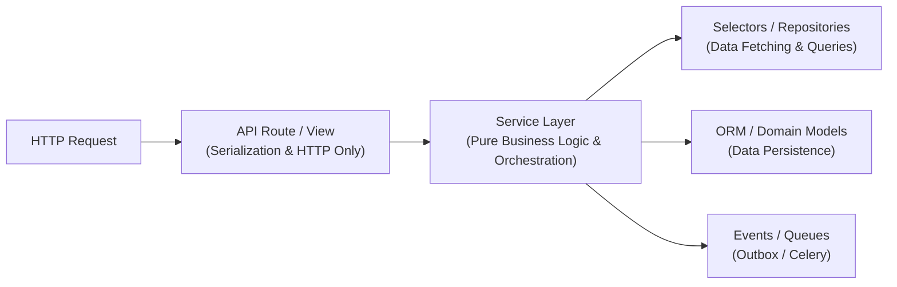

# Clean Architecture & Service Layer Pattern

In naive backend projects, business logic is often dumped inside framework controllers (Django `views.py` or FastAPI router handlers) or crammed into database entities (the notorious Django "Fat Model" anti-pattern).

In production systems, this creates tight coupling, makes unit testing painful, and leads to duplicated business rules across API endpoints, Celery workers, and CLI commands.

---

## 1. Concept & Mental Model

The **Service Layer Pattern** separates **HTTP transport concerns** (parsing headers, status codes, query params) from **core business logic** (validating business invariants, calculating balances, dispatching events).



* **Views / Routers**: Only validate the HTTP contract, authenticate the user, call the Service, and format the response.
* **Services**: Take validated input data, execute business rules inside a database transaction, and coordinate side-effects.
* **Selectors / Repositories**: Pure functions that query the database without mutating state.

---

## 2. The Production Problem (Why It Matters)

### ❌ Anti-Pattern: Fat Views & Fat Models
```python
# BAD: Business logic trapped inside DRF View or Model
class OrderViewSet(viewsets.ModelViewSet):
    def create(self, request):
        # 50 lines of payment calculations, inventory checks, email sending...
        # Cannot be reused by Celery tasks or admin scripts!
```
* **Impossible to Reuse**: If a background Celery task or batch cron job needs to execute this logic, you must duplicate code or fake an HTTP request.
* **Untestable**: Testing business logic requires spinning up full HTTP mock clients rather than fast pure-Python unit tests.

---

## 3. Production Code Implementations

=== "Django REST Framework (Service-Selector Pattern)"
    ```python
    # myapp/services/orders.py
    from decimal import Decimal
    from django.db import transaction
    from rest_framework.exceptions import ValidationError
    from myapp.models import Order, OrderItem, Product, User
    from myapp.selectors.inventory import get_available_stock

    def order_create(
        *,
        user: User,
        product_id: int,
        quantity: int,
        idempotency_key: str,
    ) -> Order:
        """
        Pure business service.
        Independent of HTTP requests, serializers, or DRF views.
        Can be safely called by views, Celery workers, or management commands.
        """
        if quantity <= 0:
            raise ValidationError({"quantity": "Quantity must be greater than zero."})

        with transaction.atomic():
            # Check stock via selector
            product = Product.objects.select_for_update().get(id=product_id)
            stock = get_available_stock(product=product)
            if stock < quantity:
                raise ValidationError({"product": f"Insufficient stock. Available: {stock}"})

            # Create order
            order = Order.objects.create(
                user=user,
                total_amount=product.price * quantity,
                idempotency_key=idempotency_key,
                status=Order.Status.PENDING,
            )
            OrderItem.objects.create(order=order, product=product, quantity=quantity, unit_price=product.price)

            # Deduct inventory
            product.stock_quantity -= quantity
            product.save(update_fields=["stock_quantity"])

            return order
    ```

    ```python
    # myapp/views/orders.py
    from rest_framework.views import APIView
    from rest_framework.response import Response
    from rest_framework import status, serializers
    from rest_framework.permissions import IsAuthenticated
    from myapp.services.orders import order_create

    class OrderCreateInputSerializer(serializers.Serializer):
        product_id = serializers.IntegerField(min_value=1)
        quantity = serializers.IntegerField(min_value=1)
        idempotency_key = serializers.CharField(max_length=64)

    class OrderCreateView(APIView):
        permission_classes = [IsAuthenticated]

        def post(self, request):
            serializer = OrderCreateInputSerializer(data=request.data)
            serializer.is_valid(raise_exception=True)

            order = order_create(
                user=request.user,
                product_id=serializer.validated_data["product_id"],
                quantity=serializer.validated_data["quantity"],
                idempotency_key=serializer.validated_data["idempotency_key"],
            )

            return Response({"order_id": order.id, "status": order.status}, status=status.HTTP_201_CREATED)
    ```

=== "FastAPI (Async Clean Architecture with Dependency Injection)"
    ```python
    # app/services/order_service.py
    from sqlalchemy.ext.asyncio import AsyncSession
    from sqlalchemy import select
    from fastapi import HTTPException, status
    from app.models.order import Order, OrderItem, Product
    from app.schemas.order import OrderCreateRequest

    class OrderService:
        def __init__(self, db: AsyncSession):
            self.db = db

        async def create_order(
            self,
            user_id: int,
            payload: OrderCreateRequest,
        ) -> Order:
            async with self.db.begin():
                # Pessimistic locking on product row
                stmt = select(Product).where(Product.id == payload.product_id).with_for_update()
                result = await self.db.execute(stmt)
                product = result.scalar_one_or_none()

                if not product:
                    raise HTTPException(status_code=status.HTTP_404_NOT_FOUND, detail="Product not found")

                if product.stock_quantity < payload.quantity:
                    raise HTTPException(
                        status_code=status.HTTP_400_BAD_REQUEST,
                        detail=f"Insufficient stock. Available: {product.stock_quantity}",
                    )

                # Deduct inventory
                product.stock_quantity -= payload.quantity

                order = Order(
                    user_id=user_id,
                    total_amount=product.price * payload.quantity,
                    idempotency_key=payload.idempotency_key,
                    status="PENDING",
                )
                self.db.add(order)
                await self.db.flush()

                order_item = OrderItem(
                    order_id=order.id,
                    product_id=product.id,
                    quantity=payload.quantity,
                    unit_price=product.price,
                )
                self.db.add(order_item)
                return order
    ```

    ```python
    # app/api/v1/orders.py
    from fastapi import APIRouter, Depends, status
    from sqlalchemy.ext.asyncio import AsyncSession
    from app.core.database import get_db
    from app.core.auth import get_current_user
    from app.schemas.order import OrderCreateRequest, OrderResponse
    from app.services.order_service import OrderService

    router = APIRouter(prefix="/orders", tags=["Orders"])

    def get_order_service(db: AsyncSession = Depends(get_db)) -> OrderService:
        return OrderService(db=db)

    @router.post("/", response_model=OrderResponse, status_code=status.HTTP_201_CREATED)
    async def create_order_endpoint(
        payload: OrderCreateRequest,
        current_user = Depends(get_current_user),
        service: OrderService = Depends(get_order_service),
    ):
        order = await service.create_order(user_id=current_user.id, payload=payload)
        return order
    ```

---

## 4. Production Checklist
- [ ] Views/Controllers have **zero** database business queries (only input parsing and status codes).
- [ ] Services use keyword-only arguments (`*`) for clear, explicit call sites.
- [ ] Transactions (`transaction.atomic()` or `db.begin()`) encompass all related mutations.
- [ ] Service functions can be tested with plain Pytest without mocking Django/FastAPI HTTP request objects.

