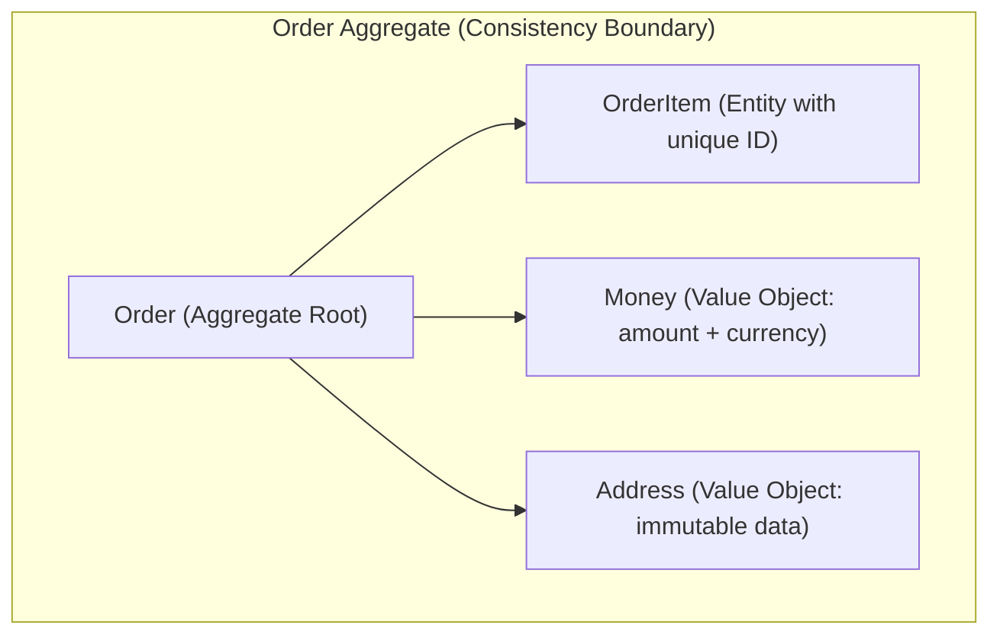
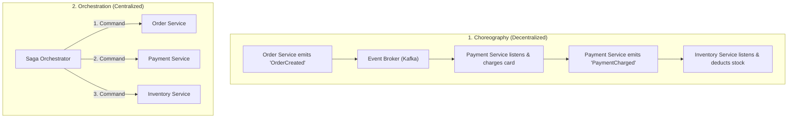

# Domain-Driven Design (DDD) & Event-Driven Architecture (EDA)

As backend applications grow to hundreds of thousands of lines of code, standard CRUD models break down. Business logic bleeds across views, models, serializers, and external scripts.

**Domain-Driven Design (DDD)** and **Event-Driven Architecture (EDA)** structure enterprise software around business concepts, ensuring that code matches real-world domain rules.

---

## 1. Core Building Blocks of DDD



| DDD Concept | Definition | Production Example |
| :--- | :--- | :--- |
| **Entity** | An object defined by its persistent identity, not its attributes. | A `User` or `Order` with an immutable primary key `id`. |
| **Value Object** | An immutable object defined entirely by its attributes without an ID. Two with identical attributes are equal. | `Money(amount=100, currency="USD")` or `Address(street, city, zip)`. |
| **Aggregate Root** | The parent entity that gates and controls all mutations to child entities within its boundary. | `Order` is the aggregate root for `OrderItem`. You never update an `OrderItem` directly; you call `order.add_item(...)`. |
| **Domain Event** | A record that something important happened in the business domain. | `OrderPlaced`, `UserRegistered`, `PaymentFailed`. |
| **Bounded Context** | A clear boundary within which a domain model applies consistently. | The concept of "Customer" in the *Sales Context* is different from "Customer" in the *Shipping Context*. |

---

## 2. Implementing Value Objects & Aggregates in Python

=== "Value Object with Python Dataclass (Immutable)"
    ```python
    from dataclasses import dataclass
    from decimal import Decimal

    @dataclass(frozen=True)  # frozen=True enforces immutability
    class Money:
        amount: Decimal
        currency: str

        def __post_init__(self):
            if self.amount < Decimal("0.00"):
                raise ValueError("Money amount cannot be negative.")

        def add(self, other: "Money") -> "Money":
            if self.currency != other.currency:
                raise ValueError(f"Cannot add {self.currency} to {other.currency}")
            return Money(amount=self.amount + other.amount, currency=self.currency)
    ```

=== "Aggregate Root Enforcing Invariants"
    ```python
    from typing import list
    from datetime import datetime, timezone

    class OrderAggregate:
        def __init__(self, order_id: str, customer_id: int):
            self.id = order_id
            self.customer_id = customer_id
            self.status = "DRAFT"
            self.items: list[dict] = []
            self.domain_events: list[object] = []

        def add_line_item(self, product_id: int, quantity: int, unit_price: float):
            # Invariant: Cannot modify confirmed orders
            if self.status != "DRAFT":
                raise ValueError("Cannot add items to an order that is already confirmed.")

            self.items.append({"product_id": product_id, "quantity": quantity, "price": unit_price})

        def confirm(self):
            if not self.items:
                raise ValueError("Cannot confirm an order with zero items.")

            self.status = "CONFIRMED"
            # Record Domain Event
            self.domain_events.append({
                "event_name": "OrderConfirmed",
                "order_id": self.id,
                "occurred_at": datetime.now(timezone.utc).isoformat(),
            })
    ```

---

## 3. Event-Driven Architecture (EDA): Choreography vs. Orchestration

When an aggregate state changes, how do other parts of the system react?



* **Choreography**: Low coupling. Services listen to events and decide independently. Best for simple, decoupled workflows.
* **Orchestration**: A central orchestrator explicitly coordinates each step. Best for complex multi-step financial sagas requiring rollbacks.

