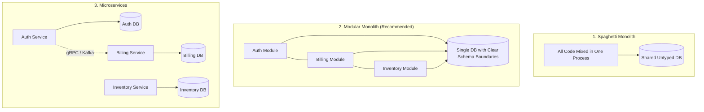

# Monolith vs. Microservices vs. Modular Monolith

A major architecture decision for any engineering team is choosing between a **Monolithic Architecture**, **Microservices Architecture**, or a **Modular Monolith**. 

In high-growth companies, prematurely jumping to microservices introduces massive operational overhead: distributed transactions, network latency, dual-write hazards, and deployment complexities.

---

## 1. Architectural Comparison



| Criteria | Monolith | Modular Monolith | Microservices |
| :--- | :--- | :--- | :--- |
| **Deployment Complexity** | Low (Single artifact/container) | Low (Single artifact/container) | High (Kubernetes, Service Meshes) |
| **Transaction Boundaries** | ACID transactions supported | ACID transactions supported | Distributed (Saga / 2PC required) |
| **Observability** | Single application trace | Single application trace | Distributed tracing required (OTel) |
| **Team Scalability** | Low (Merge conflicts, slow CI) | High (Distinct module owners) | High (Independent deploy cycles) |
| **Performance Overhead** | None (In-memory function calls) | None (In-memory function calls) | High (Network serialization/RPC) |

---

## 2. The Modular Monolith Pattern

The industry standard starting point for 95% of applications is the **Modular Monolith**:
1. All modules run in the **same runtime process** and share the same repository.
2. Modules **never import internal models or private logic** from another module directly.
3. Modules communicate via **explicit public interfaces** (Public Services or In-Memory Domain Events).

---

## 3. Implementation in Django & FastAPI

=== "Django (App-Level Boundaries)"
    In Django, each modular boundary corresponds to an isolated app inside `apps/`:
    ```
    myproject/
    ├── apps/
    │   ├── accounts/
    │   │   ├── services.py      # Public interface
    │   │   ├── selectors.py     # Public read interface
    │   │   └── models.py        # Private database models
    │   ├── billing/
    │   │   ├── services.py
    │   │   └── models.py
    ```
    **Rule**: `billing/services.py` must never query `accounts.models.User.objects.filter(...)` directly. Instead, it calls `accounts.selectors.get_user_by_id(user_id=...)`.

=== "FastAPI (Domain Packages)"
    In FastAPI, clean package boundaries are enforced using domain-driven packaging:
    ```
    app/
    ├── modules/
    │   ├── identity/
    │   │   ├── domain/
    │   │   ├── service.py
    │   │   └── router.py
    │   ├── orders/
    │   │   ├── domain/
    │   │   ├── service.py
    │   │   └── router.py
    ```
    Dependencies between modules are injected via FastAPI's `Depends` or passed as typed DTO interfaces.

---

## 4. When to Transition to Microservices
Only break a module into an independent microservice when:
1. **Independent Scaling**: One specific module has vastly different resource demands (e.g., CPU-heavy video transcoding vs simple CRUD).
2. **Autonomous Teams**: Multiple teams (50+ engineers) are stepping on each other's git branches and release schedules.
3. **Different Tech Stacks**: A module requires Go/Rust for ultra-low latency while the rest of the app is Python.

