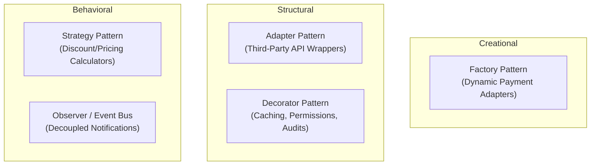

# SOLID Principles & Design Patterns in Backend Python

Writing maintainable, enterprise-level backend code requires applying **SOLID principles** and battle-tested **design patterns** without falling into Java-style over-engineering.

---

## 1. SOLID Principles in Python Backend Engineering

### S: Single Responsibility Principle (SRP)
* **Definition**: A class or module should have one, and only one, reason to change.
* **Production Context**: Keep database models strictly responsible for state persistence. Move validation rules to Schemas/Serializers, and orchestration logic to Services.

### O: Open/Closed Principle (OCP)
* **Definition**: Software entities should be open for extension, but closed for modification.
* **Production Example**: Implementing a notification engine where new channels (SMS, Email, Slack, WhatsApp) are added by implementing a base adapter class rather than modifying an endless `if-elif` statement.

### L: Liskov Substitution Principle (LSP)
* **Definition**: Subclasses must be substitutable for their base types without altering program correctness.

### I: Interface Segregation Principle (ISP)
* **Definition**: Clients should not be forced to depend on methods they do not use. Prefer narrow `Protocol` classes (`typing.Protocol`) over monolithic abstract classes.

### D: Dependency Inversion Principle (DIP)
* **Definition**: High-level modules should not depend on low-level modules; both should depend on abstractions.

---

## 2. Core Backend Design Patterns



---

## 3. Production Code Implementations

### The Strategy & Adapter Pattern: Pluggable Payment Gateways

=== "Django REST Framework"
    ```python
    from typing import Protocol
    from decimal import Decimal

    class PaymentGateway(Protocol):
        def charge(self, amount: Decimal, currency: str, token: str) -> str:
            """Charges payment and returns external transaction ID"""
            ...

    class StripeGateway:
        def charge(self, amount: Decimal, currency: str, token: str) -> str:
            # Stripe API client call
            return "stripe_ch_12345"

    class PayPalGateway:
        def charge(self, amount: Decimal, currency: str, token: str) -> str:
            # PayPal API client call
            return "paypal_tx_67890"

    # Factory/Provider
    def get_payment_gateway(provider: str) -> PaymentGateway:
        gateways = {
            "stripe": StripeGateway,
            "paypal": PayPalGateway,
        }
        gateway_cls = gateways.get(provider.lower())
        if not gateway_cls:
            raise ValueError(f"Unsupported payment provider: {provider}")
        return gateway_cls()
    ```

=== "FastAPI (Injected via Depends)"
    ```python
    from typing import Annotated, Protocol
    from decimal import Decimal
    from fastapi import APIRouter, Depends, Header, HTTPException, status
    from pydantic import BaseModel

    class PaymentGateway(Protocol):
        async def charge(self, amount: Decimal, currency: str, token: str) -> str:
            ...

    class StripeGateway:
        async def charge(self, amount: Decimal, currency: str, token: str) -> str:
            return "stripe_async_ch_987"

    class PayPalGateway:
        async def charge(self, amount: Decimal, currency: str, token: str) -> str:
            return "paypal_async_tx_543"

    def get_gateway(x_payment_provider: Annotated[str, Header()] = "stripe") -> PaymentGateway:
        if x_payment_provider == "stripe":
            return StripeGateway()
        elif x_payment_provider == "paypal":
            return PayPalGateway()
        raise HTTPException(status_code=status.HTTP_400_BAD_REQUEST, detail="Invalid provider")

    router = APIRouter(prefix="/payments", tags=["Payments"])

    class CheckoutRequest(BaseModel):
        amount: Decimal
        currency: str
        token: str

    @router.post("/checkout")
    async def process_checkout(
        payload: CheckoutRequest,
        gateway: Annotated[PaymentGateway, Depends(get_gateway)],
    ):
        tx_id = await gateway.charge(payload.amount, payload.currency, payload.token)
        return {"status": "SUCCESS", "transaction_id": tx_id}
    ```

