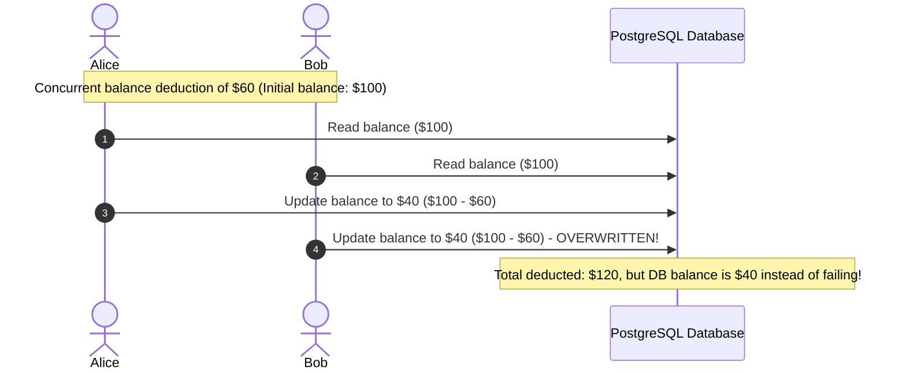

# Database Concurrency: Pessimistic vs. Optimistic Locking

In high-concurrency systems (flash sales, crypto/fintech wallets, ticketing, inventory reservations), multiple requests attempt to read and mutate the same database record simultaneously.

Without concurrency controls, you get **race conditions** and **double spending**.

---

## 1. Concept & Mental Model



There are two primary paradigms to resolve this:

1. **Pessimistic Locking (`SELECT FOR UPDATE`)**: Lock the row in the database at read-time so other transactions must wait until the lock is released.
2. **Optimistic Locking (Version / Timestamp Check)**: Don't lock on read; instead, verify at write-time that the row has not changed (`WHERE id = :id AND version = :version`). If changed, abort and retry.

| Strategy | Contention Level | Overhead | Best Suited For |
| :--- | :--- | :--- | :--- |
| **Pessimistic** | High contention | Holds DB locks; risk of deadlocks if unordered | Financial transfers, inventory deduction, seat reservations |
| **Optimistic** | Low to medium contention | No locks; high abort/retry rate under heavy writes | User profile updates, document editing, CMS |

---

## 2. Advanced Pessimistic Modifiers

PostgreSQL provides powerful modifiers for `SELECT ... FOR UPDATE`:

* **`NOWAIT`**: If the row is already locked by another transaction, fail immediately with an error rather than blocking the worker thread.
* **`SKIP LOCKED`**: Skip any locked rows and return only unlocked ones. **This is the foundation of high-performance database-backed job queues** (e.g. Celery / background worker consumers).

---

## 3. Production Code Implementations

### Problem: Deduct Wallet Balance Safely

=== "Django REST Framework (Pessimistic with `select_for_update`)"
    ```python
    from decimal import Decimal
    from django.db import transaction
    from rest_framework.exceptions import ValidationError
    from myapp.models import Wallet, LedgerEntry

    def wallet_debit_pessimistic(
        *,
        wallet_id: int,
        amount: Decimal,
        reference_id: str,
    ) -> LedgerEntry:
        """
        Pessimistic locking using select_for_update().
        Guarantees serializable isolation on this specific wallet row.
        """
        if amount <= Decimal("0.00"):
            raise ValidationError({"amount": "Debit amount must be positive."})

        with transaction.atomic():
            # select_for_update locks this specific row until transaction commits
            wallet = (
                Wallet.objects
                .select_for_update()
                .get(id=wallet_id)
            )

            if wallet.balance < amount:
                raise ValidationError({"balance": "Insufficient funds in wallet."})

            wallet.balance -= amount
            wallet.save(update_fields=["balance", "updated_at"])

            ledger = LedgerEntry.objects.create(
                wallet=wallet,
                amount=-amount,
                reference_id=reference_id,
                balance_after=wallet.balance,
            )
            return ledger
    ```

=== "FastAPI (SQLAlchemy 2.0 Async with `with_for_update`)"
    ```python
    from decimal import Decimal
    from sqlalchemy.ext.asyncio import AsyncSession
    from sqlalchemy import select
    from fastapi import HTTPException, status
    from app.models.wallet import Wallet, LedgerEntry

    async def wallet_debit_pessimistic(
        db: AsyncSession,
        wallet_id: int,
        amount: Decimal,
        reference_id: str,
    ) -> LedgerEntry:
        if amount <= Decimal("0.00"):
            raise HTTPException(
                status_code=status.HTTP_400_BAD_REQUEST,
                detail="Debit amount must be positive."
            )

        async with db.begin():
            # with_for_update() applies SELECT ... FOR UPDATE
            stmt = (
                select(Wallet)
                .where(Wallet.id == wallet_id)
                .with_for_update()
            )
            result = await db.execute(stmt)
            wallet = result.scalar_one_or_none()

            if not wallet:
                raise HTTPException(status_code=status.HTTP_404_NOT_FOUND, detail="Wallet not found")

            if wallet.balance < amount:
                raise HTTPException(
                    status_code=status.HTTP_400_BAD_REQUEST,
                    detail="Insufficient funds."
                )

            wallet.balance -= amount

            ledger = LedgerEntry(
                wallet_id=wallet.id,
                amount=-amount,
                reference_id=reference_id,
                balance_after=wallet.balance,
            )
            db.add(ledger)
            await db.flush()
            return ledger
    ```

---

## 4. Optimistic Locking Implementation

In optimistic concurrency, we use an integer `version` field:

```python
# Django ORM Optimistic Pattern
updated_rows = Wallet.objects.filter(
    id=wallet_id,
    version=current_version,
    balance__gte=amount,
).update(
    balance=models.F("balance") - amount,
    version=models.F("version") + 1,
)

if updated_rows == 0:
    raise ConcurrentUpdateConflict("Row was updated by another request. Retry.")
```

---

## 5. Production Checklist
- [ ] Multi-row locks are always acquired in a consistent, deterministic order (e.g. `ORDER BY id ASC`) to prevent **deadlocks**.
- [ ] Locks are held for the shortest time possible — **never execute HTTP calls, email sending, or slow external I/O inside a locked transaction**.
- [ ] For background queue polling, use `select_for_update(skip_locked=True)` to avoid worker contention.

