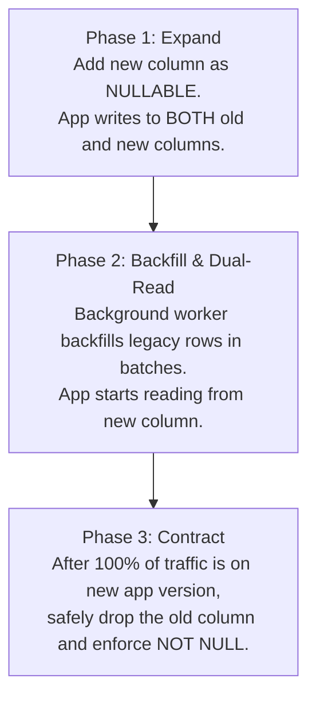

# Zero-Downtime Database Migrations: Django & Alembic

In production, running naive migrations like:
```sql
-- DANGEROUS ON A 10M ROW TABLE:
ALTER TABLE users ADD COLUMN phone_number VARCHAR(32) NOT NULL DEFAULT '';
ALTER TABLE orders RENAME COLUMN price TO total_amount;
```
will acquire an **Exclusive Table Lock (`ACCESS EXCLUSIVE`)**, freezing all incoming reads and writes, timing out client requests, and taking down the API.

Moreover, in rolling deployments, **old application code and new application code run simultaneously for 10-20 minutes**. If you rename a column, the old containers crash instantly!

---

## 1. The Expand-and-Contract Migration Pattern

To migrate schemas with zero downtime across rolling deployments, follow the 3-step **Expand and Contract Pattern**:



---

## 2. Safe vs. Dangerous Migration Rules in PostgreSQL

| Operation | Why It Is Dangerous | Safe Production Alternative |
| :--- | :--- | :--- |
| **Adding a `NOT NULL` column without default** | Fails if existing rows exist. | 1. Add as nullable.<br>2. Backfill in batches.<br>3. Add `NOT NULL` constraint via `VALIDATE CONSTRAINT`. |
| **Adding an Index on a large table** | Locks the entire table against writes for minutes/hours. | Use `CREATE INDEX CONCURRENTLY` (non-blocking). |
| **Renaming a column** | Instantly breaks old running containers that query the old name. | Add new column, dual-write, migrate, then drop old column. |
| **Dropping a table or column** | Immediate hard failure if rollback is needed. | Deprecate in code first; remove from schema in a subsequent release. |

---

## 3. Production Code Implementations

=== "Django Migrations: Concurrent Indexing"
    ```python
    # myapp/migrations/0005_add_concurrent_index.py
    from django.db import migrations
    from django.contrib.postgres.operations import AddIndexConcurrently
    from django.db import models

    class Migration(migrations.Migration):
        # atomic = False is REQUIRED for concurrent operations in PostgreSQL!
        atomic = False

        dependencies = [
            ("myapp", "0004_previous_migration"),
        ]

        operations = [
            AddIndexConcurrently(
                model_name="order",
                index=models.Index(fields=["created_at"], name="idx_order_created_at_concurrent"),
            ),
        ]
    ```

=== "FastAPI / Alembic Migration Script"
    ```python
    # alembic/versions/rev_add_phone_concurrently.py
    from alembic import op
    import sqlalchemy as sa

    def upgrade() -> None:
        # Use autocommit block for concurrent operations in PostgreSQL
        with op.get_context().autocommit_block():
            op.execute("""
                CREATE INDEX CONCURRENTLY IF NOT EXISTS idx_users_phone 
                ON users (phone_number);
            """)

    def downgrade() -> None:
        with op.get_context().autocommit_block():
            op.execute("DROP INDEX CONCURRENTLY IF EXISTS idx_users_phone;")
    ```

---

## 4. Batched Data Backfilling Script

Never update 1,000,000 rows in a single SQL query (`UPDATE users SET new_col = old_col;`). It will blow up transaction logs (WAL) and lock rows. Backfill in small batches:

```python
# Management command or migration utility
def backfill_in_batches(batch_size: int = 2000):
    last_id = 0
    while True:
        # Query batch by ID (O(1) index scan)
        users = list(User.objects.filter(id__gt=last_id, new_col__isnull=True).order_by("id")[:batch_size])
        if not users:
            break

        for u in users:
            u.new_col = calculate_new_val(u)

        User.objects.bulk_update(users, ["new_col"])
        last_id = users[-1].id
        time.sleep(0.05)  # Yield CPU and reduce DB replication lag
```

