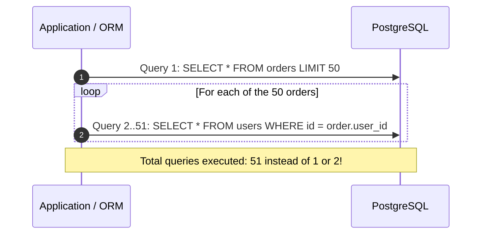

# Eliminating the N+1 Query Problem in Django & FastAPI

The **N+1 Query Problem** occurs when an application executes 1 query to fetch $N$ parent records, and then executes $N$ additional queries to fetch related child records in a loop.

A view returning 50 items can suddenly execute 51, 101, or 201 individual SQL queries, causing latency spikes and exhausting database connection pools.

---

## 1. Concept & Mental Model



---

## 2. Join Strategies: Django vs. SQLAlchemy (FastAPI)

Relational ORMs provide two primary mechanisms to solve N+1:

| Technique | SQL Strategy | When to Use | Django ORM | SQLAlchemy (FastAPI) |
| :--- | :--- | :--- | :--- | :--- |
| **SQL JOIN** | `LEFT OUTER JOIN` in a single query | 1-to-1 or Many-to-1 (Foreign Key) | `select_related()` | `joinedload()` |
| **Separate `IN` Query** | 1st query + 2nd query `WHERE id IN (...)` | 1-to-Many or Many-to-Many | `prefetch_related()` | `selectinload()` |

---

## 3. Production Code Implementations

=== "Django REST Framework"
    ```python
    # BAD: Triggers N+1 queries when serialized
    orders = Order.objects.filter(status="PAID")
    # In serializer:
    # order.user.email  --> Triggers query per order!
    # [item.product.name for item in order.items.all()] --> Triggers queries per item!

    # GOOD: Fully optimized with select_related & prefetch_related
    from django.db.models import Prefetch
    from myapp.models import Order, OrderItem

    orders = (
        Order.objects
        .filter(status="PAID")
        # 1-to-1 or Foreign Key -> SQL JOIN
        .select_related("user")
        # Many-to-Many or Reverse Foreign Key -> Separate IN query
        .prefetch_related(
            Prefetch(
                "items",
                queryset=OrderItem.objects.select_related("product"),
            )
        )
    )
    # Total queries: Exactly 2 queries, regardless of how many orders exist!
    ```

    > **Tip**: Use `django-silk` or `nplusone` in local development to automatically fail test suites if an N+1 query is introduced.

=== "FastAPI (SQLAlchemy 2.0 Async)"
    ```python
    from sqlalchemy import select
    from sqlalchemy.orm import selectinload, joinedload
    from sqlalchemy.ext.asyncio import AsyncSession
    from app.models.order import Order, OrderItem

    async def get_paid_orders_optimized(db: AsyncSession) -> list[Order]:
        stmt = (
            select(Order)
            .where(Order.status == "PAID")
            # joinedload for Foreign Key (User)
            .options(joinedload(Order.user))
            # selectinload for 1-to-Many (Items and their Products)
            .options(
                selectinload(Order.items).joinedload(OrderItem.product)
            )
        )
        result = await db.execute(stmt)
        # unique() is required when using joinedload with collections
        return result.scalars().unique().all()
    ```

---

## 4. Production Checklist
- [ ] Every API list endpoint has explicit query logging enabled in development tests.
- [ ] Foreign Keys use `select_related` / `joinedload`.
- [ ] Collections and Many-to-Many relationships use `prefetch_related` / `selectinload`.
- [ ] Use `django.test.utils.CaptureQueriesContext` in unit tests to assert strict query count limits:
  ```python
  with self.assertNumQueries(2):
      response = client.get("/api/v1/orders/")
  ```

