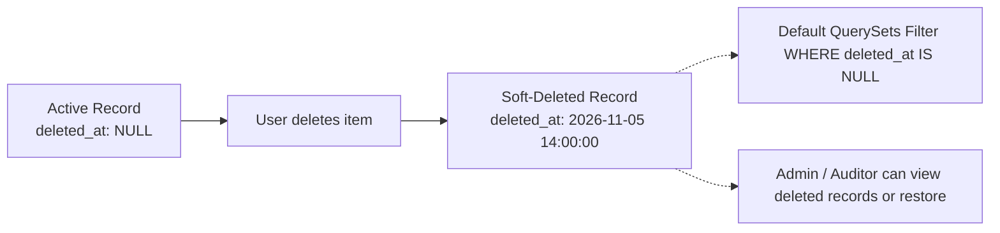

# Soft Deletes & Temporal Audit Logging

In mission-critical enterprise systems, executing `DELETE FROM table WHERE id = ...` is almost always a catastrophe. Accidental user actions, compliance requirements (GDPR, SOC2, HIPAA), and financial auditing require:

1. **Soft Deletes**: Retaining records while marking them as inactive or deleted.
2. **Temporal Audit Logs**: A timestamped, immutable record of *who* modified *what field*, *from what previous value*, *at what time*, and *from which IP address*.

---

## 1. Soft Delete Architecture



### Pitfalls of Soft Deletes:
* **Unique Constraints Clash**: If `email` has a `UNIQUE` constraint, a user who deletes their account cannot re-register with the same email unless the index is partial (`CREATE UNIQUE INDEX idx_user_email ON users(email) WHERE deleted_at IS NULL;`).
* **Foreign Key Cascade Ambiguity**: Does soft-deleting an organization automatically soft-delete its 10,000 members and invoices?

---

## 2. Production Code Implementations

=== "Django REST Framework (Custom Manager + QuerySet)"
    ```python
    from django.db import models
    from django.utils import timezone

    class SoftDeleteQuerySet(models.QuerySet):
        def delete(self):
            # Bulk soft-delete
            return self.update(deleted_at=timezone.now())

        def hard_delete(self):
            return super().delete()

        def alive(self):
            return self.filter(deleted_at__isnull=True)

        def dead(self):
            return self.filter(deleted_at__isnull=False)

    class SoftDeleteManager(models.Manager):
        def get_queryset(self):
            return SoftDeleteQuerySet(self.model, using=self._db).alive()

    class BaseModelWithSoftDelete(models.Model):
        created_at = models.DateTimeField(auto_now_add=True)
        updated_at = models.DateTimeField(auto_now=True)
        deleted_at = models.DateTimeField(null=True, blank=True, db_index=True)

        # Default manager hides soft-deleted items
        objects = SoftDeleteManager()
        # All objects manager for admin/auditing
        all_objects = models.Manager()

        class Meta:
            abstract = True

        def delete(self, using=None, keep_parents=False):
            self.deleted_at = timezone.now()
            self.save(update_fields=["deleted_at", "updated_at"])

        def restore(self):
            self.deleted_at = None
            self.save(update_fields=["deleted_at", "updated_at"])
    ```

=== "FastAPI (SQLAlchemy 2.0 Mixin & Async Interceptor)"
    ```python
    from datetime import datetime, timezone
    from sqlalchemy import Column, DateTime, select
    from sqlalchemy.orm import declarative_base

    Base = declarative_base()

    class SoftDeleteMixin:
        deleted_at = Column(DateTime(timezone=True), nullable=True, index=True)

        def soft_delete(self):
            self.deleted_at = datetime.now(timezone.utc)

        def restore(self):
            self.deleted_at = None

        @classmethod
        def active_statement(cls):
            """Returns select statement filtered for active records"""
            return select(cls).where(cls.deleted_at.is_(None))
    ```

---

## 3. Audit Logging (Temporal History)

For enterprise compliance, use **`django-simple-history`** or PostgreSQL trigger-based audit tables (`pgaudit`).

Every update generates a historical record with:
* `history_user_id`: ID of the authenticated user who executed the change.
* `history_type`: `+` (Created), `~` (Modified), `-` (Deleted).
* `history_date`: Precise timestamp with millisecond precision.
* Snapshot of all fields at that exact moment.

