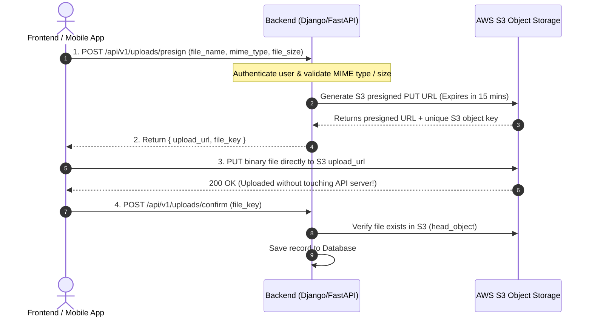

# Secure File Uploads: Direct to S3 with Presigned URLs

Streaming large file uploads (PDFs, videos, raw CSVs) directly through your Python API server is an anti-pattern in production. It saturates worker process memory, blocks thread pools, and exhausts web server connections.

The industry-standard solution is **Direct-to-Object-Storage Uploads** using **AWS S3 Presigned URLs**.

---

## 1. Presigned Upload Architecture



---

## 2. Production Code Implementations

=== "Django REST Framework"
    ```python
    import boto3
    from botocore.config import Config
    from rest_framework.views import APIView
    from rest_framework.response import Response
    from rest_framework import serializers, status
    import uuid

    s3_client = boto3.client(
        "s3",
        region_name="us-east-1",
        config=Config(signature_version="s3v4"),
    )
    BUCKET_NAME = "production-app-uploads"

    class PresignRequestSerializer(serializers.Serializer):
        file_name = serializers.CharField(max_length=255)
        mime_type = serializers.CharField(max_length=100)
        file_size = serializers.IntegerField(max_value=50 * 1024 * 1024)  # Max 50MB

    class PresignUploadView(APIView):
        def post(self, request):
            serializer = PresignRequestSerializer(data=request.data)
            serializer.is_valid(raise_exception=True)

            unique_key = f"uploads/{request.user.id}/{uuid.uuid4()}-{serializer.validated_data['file_name']}"

            presigned_url = s3_client.generate_presigned_url(
                ClientMethod="put_object",
                Params={
                    "Bucket": BUCKET_NAME,
                    "Key": unique_key,
                    "ContentType": serializer.validated_data["mime_type"],
                },
                ExpiresIn=900,  # 15 minutes
            )

            return Response({
                "upload_url": presigned_url,
                "file_key": unique_key,
            }, status=status.HTTP_200_OK)
    ```

=== "FastAPI (Async S3 with `aioboto3`)"
    ```python
    import uuid
    import aioboto3
    from fastapi import APIRouter, Depends, HTTPException, status
    from pydantic import BaseModel, Field

    router = APIRouter(prefix="/uploads", tags=["Uploads"])
    BUCKET_NAME = "production-app-uploads"

    class PresignRequest(BaseModel):
        file_name: str
        mime_type: str
        file_size_bytes: int = Field(le=50 * 1024 * 1024)  # 50MB limit

    @router.post("/presign")
    async def create_presigned_url(payload: PresignRequest):
        session = aioboto3.Session()
        unique_key = f"uploads/{uuid.uuid4()}-{payload.file_name}"

        async with session.client("s3", region_name="us-east-1") as s3:
            presigned_url = await s3.generate_presigned_url(
                ClientMethod="put_object",
                Params={
                    "Bucket": BUCKET_NAME,
                    "Key": unique_key,
                    "ContentType": payload.mime_type,
                },
                ExpiresIn=900,
            )

        return {"upload_url": presigned_url, "file_key": unique_key}
    ```

---

## 3. Production Security Checklist
- [ ] Whitelist allowed MIME types (e.g. `image/jpeg`, `application/pdf`). Never allow executable uploads (`.exe`, `.sh`, `.html`).
- [ ] Never expose raw S3 URLs publicly if files contain private PII; serve private files via **CloudFront Signed URLs** or short-lived presigned GET URLs.
- [ ] Configure S3 Lifecycle policies to automatically delete unconfirmed uploads after 48 hours.

