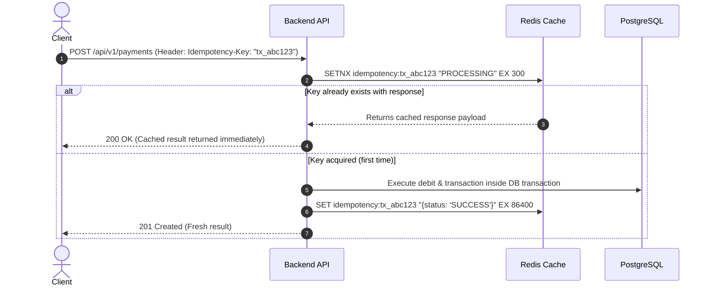

# API Idempotency & Webhook Verification

Networks are unreliable. Mobile apps drop connections, load balancers retry timed-out requests, and payment gateways resend webhooks.

An **Idempotent API** guarantees that executing an identical request multiple times produces the exact same outcome as executing it once, without accidental double-charges or duplicate records.

---

## 1. Idempotency Key Architecture



---

## 2. Production Code Implementations

=== "Django REST Framework (Idempotency Middleware)"
    ```python
    import json
    from django.core.cache import cache
    from django.http import JsonResponse

    class IdempotencyMiddleware:
        def __init__(self, get_response):
            self.get_response = get_response

        def __call__(self, request):
            if request.method not in ["POST", "PATCH"]:
                return self.get_response(request)

            idempotency_key = request.headers.get("Idempotency-Key")
            if not idempotency_key:
                return self.get_response(request)

            cache_key = f"idempotency:{idempotency_key}"
            cached_data = cache.get(cache_key)

            if cached_data:
                # Return previously cached response directly
                return JsonResponse(cached_data["body"], status=cached_data["status"])

            response = self.get_response(request)

            # If response is successful, cache it for 24 hours
            if 200 <= response.status_code < 300 and hasattr(response, "data"):
                cache.set(
                    cache_key,
                    {"status": response.status_code, "body": response.data},
                    timeout=86400,
                )

            return response
    ```

=== "FastAPI (Webhook Signature Verification with HMAC)"
    ```python
    import hmac
    import hashlib
    from fastapi import APIRouter, Request, Header, HTTPException, status

    router = APIRouter(prefix="/webhooks", tags=["Webhooks"])
    WEBHOOK_SECRET = b"whsec_super_secret_production_key"

    @router.post("/stripe")
    async def handle_stripe_webhook(
        request: Request,
        stripe_signature: str = Header(..., alias="Stripe-Signature"),
    ):
        body = await request.body()

        # Compute HMAC SHA-256 signature
        expected_sig = hmac.new(WEBHOOK_SECRET, body, hashlib.sha256).hexdigest()

        # Constant-time comparison to prevent timing attacks
        if not hmac.compare_digest(stripe_signature, expected_sig):
            raise HTTPException(
                status_code=status.HTTP_400_BAD_REQUEST,
                detail="Invalid webhook signature",
            )

        payload = await request.json()
        event_type = payload.get("type")

        # Process webhook event idempotently
        return {"status": "received"}
    ```

---

## 3. Production Rules
* Always use `hmac.compare_digest()` instead of `==` to prevent **timing attacks**.
* Idempotency keys should expire after a standard TTL (e.g. 24 hours).
* Return a `409 Conflict` if a second identical request arrives while the first is still marked as `"PROCESSING"`.

