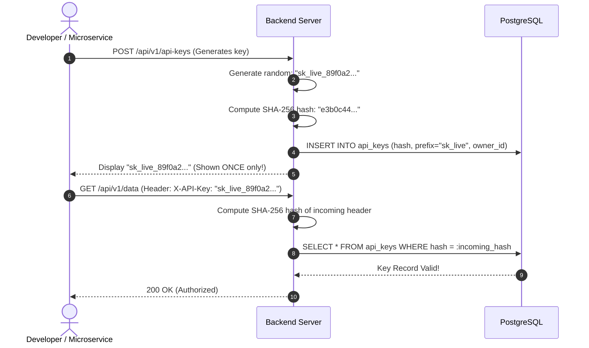

# Service-to-Service API Key Authentication

When external microservices, partners, or cron workers call your backend, using user interactive sessions or short-lived OAuth tokens is cumbersome. 

The industry standard is **API Key Authentication** (similar to Stripe or OpenAI keys: `sk_live_12345...`).

---

## 1. The Cardinal Rule of API Key Security
> **Never store plaintext API keys in your database.** If your database is compromised or leaked via an SQL injection or backup snapshot, all customer API keys would be exposed in plaintext.

Instead, follow the **GitHub / Stripe Pattern**:
1. Generate a random high-entropy token with a recognizable prefix: `sk_live_abcdef...`
2. Show the key to the developer **only once** upon creation.
3. Compute and store the **SHA-256 Hash** in the database.
4. When incoming requests arrive, hash the submitted key and query by the hash using constant-time comparison.



---

## 2. Production Code Implementations

=== "FastAPI (Async API Key Dependency)"
    ```python
    import hashlib
    import secrets
    from fastapi import Security, HTTPException, status
    from fastapi.security import APIKeyHeader
    from sqlalchemy.ext.asyncio import AsyncSession
    from sqlalchemy import select

    api_key_header = APIKeyHeader(name="X-API-Key", auto_error=False)

    def generate_new_api_key() -> tuple[str, str]:
        """Returns (raw_key, hashed_key)"""
        raw_token = "sk_live_" + secrets.token_urlsafe(32)
        hashed_token = hashlib.sha256(raw_token.encode()).hexdigest()
        return raw_token, hashed_token

    async def get_api_key_auth(
        api_key: str = Security(api_key_header),
        db: AsyncSession = Depends(get_db),
    ):
        if not api_key:
            raise HTTPException(status_code=status.HTTP_401_UNAUTHORIZED, detail="Missing X-API-Key header")

        # Hash incoming key
        hashed_incoming = hashlib.sha256(api_key.encode()).hexdigest()

        # Query database by hash
        stmt = select(APIKeyRecord).where(APIKeyRecord.hashed_key == hashed_incoming, APIKeyRecord.is_active == True)
        result = await db.execute(stmt)
        key_record = result.scalar_one_or_none()

        if not key_record:
            raise HTTPException(status_code=status.HTTP_403_FORBIDDEN, detail="Invalid or revoked API key")

        return key_record
    ```

=== "Django REST Framework (BaseAuthentication Class)"
    ```python
    import hashlib
    from rest_framework.authentication import BaseAuthentication
    from rest_framework.exceptions import AuthenticationFailed
    from myapp.models import APIKeyRecord

    class APIKeyAuthentication(BaseAuthentication):
        def authenticate(self, request):
            raw_key = request.headers.get("X-API-Key")
            if not raw_key:
                return None  # Pass to next authentication class

            hashed = hashlib.sha256(raw_key.encode()).hexdigest()
            try:
                record = APIKeyRecord.objects.select_related("user").get(hashed_key=hashed, is_active=True)
            except APIKeyRecord.DoesNotExist:
                raise AuthenticationFailed("Invalid API Key")

            # Return (user, auth) tuple
            return (record.user, record)
    ```

