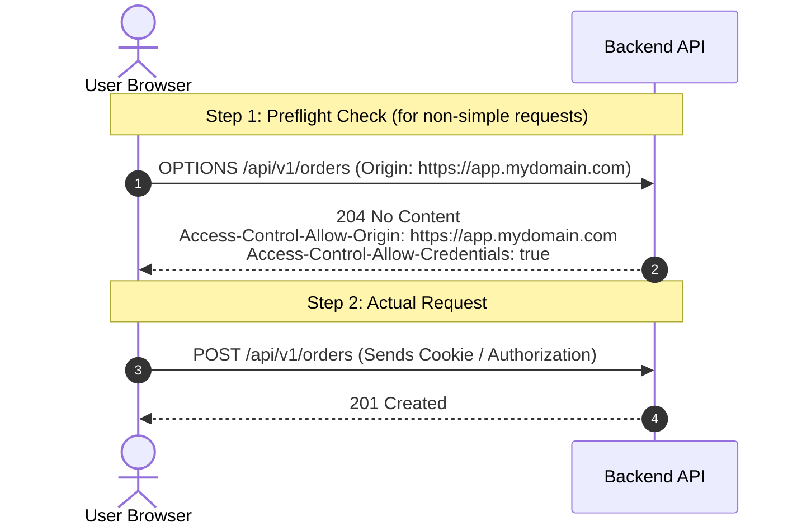
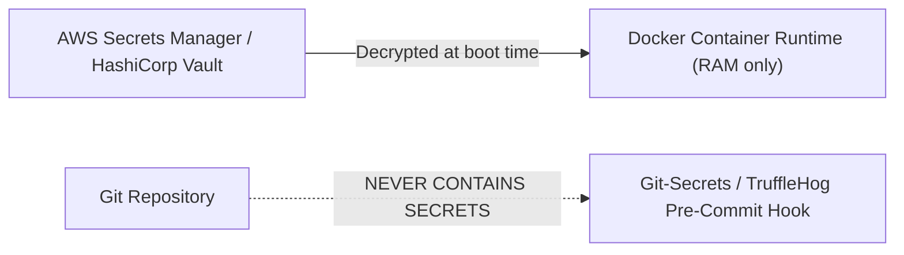

# CORS, CSP & Enterprise Secrets Management

Security does not stop at user authentication. A misconfigured CORS header allows malicious websites to steal user data from authenticated browser sessions, and leaked plaintext credentials in Git repositories account for millions of dollars in breaches every year.

---

## 1. Cross-Origin Resource Sharing (CORS) Masterclass

When a frontend running on `https://app.mydomain.com` calls your API at `https://api.mydomain.com`, the browser blocks the response unless your backend explicitly permits it via CORS headers.



### The Fatal CORS Mistake:
```python
# DANGEROUS DISASTER IN PRODUCTION:
# Setting allow_origins=["*"] AND allow_credentials=True
# Modern browsers reject this combination because it allows any malicious website on the internet
# to make authenticated credentialed requests to your API!
```

=== "FastAPI CORS Configuration"
    ```python
    from fastapi.middleware.cors import CORSMiddleware

    app.add_middleware(
        CORSMiddleware,
        allow_origins=[
            "https://app.mydomain.com",
            "https://admin.mydomain.com",
        ],
        allow_credentials=True,
        allow_methods=["GET", "POST", "PUT", "PATCH", "DELETE", "OPTIONS"],
        allow_headers=["Authorization", "Content-Type", "Idempotency-Key", "X-Correlation-ID"],
        max_age=86400, # Cache preflight response for 24 hours
    )
    ```

---

## 2. Content Security Policy (CSP)

CSP is an HTTP response header that instructs the browser which domains are permitted to execute scripts, fetch images, or load iframes, preventing Cross-Site Scripting (XSS) and clickjacking.

```http
Content-Security-Policy: default-src 'self'; script-src 'self'; frame-ancestors 'none'; object-src 'none';
```

---

## 3. Enterprise Secrets Management

In production, **no developer should ever know production passwords or have them on their local laptops**.



### Best Practices:
1. **Pre-Commit Secrets Scanning**: Install `trufflehog` or `gitleaks` in pre-commit hooks to block developers from accidentally pushing `.env` files or API keys.
2. **Automated Rotation**: Configure AWS Secrets Manager or Vault to rotate database credentials automatically every 30 days without application downtime.

