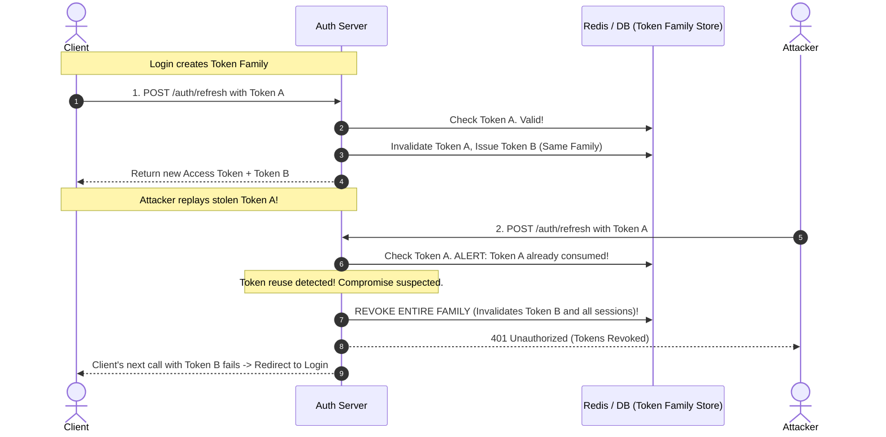

# JWT Token Rotation & Reuse Detection (Family Revocation)

JSON Web Tokens (JWTs) are stateless by nature: once signed, a JWT cannot be invalidated before its expiration unless verified against a revocation list.

In high-security production backends, relying solely on stateless JWTs is dangerous: if an attacker steals an access token or refresh token, they retain access until expiration.

The industry-standard solution is **Refresh Token Rotation with Family Revocation Detection** (RFC 6749 / OAuth 2.0 Security BCP).

---

## 1. Token Lifecycles & Token Family Architecture



---

## 2. Production Code Implementations

=== "Django REST Framework (SimpleJWT Token Blacklist)"
    In `settings.py`:
    ```python
    from datetime import timedelta

    SIMPLE_JWT = {
        "ACCESS_TOKEN_LIFETIME": timedelta(minutes=15),
        "REFRESH_TOKEN_LIFETIME": timedelta(days=7),
        # Crucial for security:
        "ROTATE_REFRESH_TOKENS": True,
        "BLACKLIST_AFTER_ROTATION": True,
        "UPDATE_LAST_LOGIN": True,
        "AUTH_HEADER_TYPES": ("Bearer",),
    }

    # Installed apps must include:
    INSTALLED_APPS = [
        ...
        "rest_framework_simplejwt.token_blacklist",
    ]
    ```

    Whenever `/api/token/refresh/` is called, SimpleJWT blacklists the old refresh token in the database. If an already blacklisted token is presented, SimpleJWT raises an `InvalidToken` exception.

=== "FastAPI (Async Token Family Engine with Redis)"
    ```python
    import uuid
    from datetime import datetime, timezone, timedelta
    from jose import jwt, JWTError
    from redis.asyncio import Redis
    from fastapi import APIRouter, HTTPException, status, Depends
    from pydantic import BaseModel

    SECRET_KEY = "production_super_secret_signing_key"
    ALGORITHM = "HS256"

    router = APIRouter(prefix="/auth", tags=["Auth"])

    class RefreshRequest(BaseModel):
        refresh_token: str

    async def get_redis():
        client = Redis.from_url("redis://localhost:6379/0", decode_responses=True)
        try:
            yield client
        finally:
            await client.aclose()

    @router.post("/refresh")
    async def rotate_refresh_token(payload: RefreshRequest, redis: Redis = Depends(get_redis)):
        try:
            decoded = jwt.decode(payload.refresh_token, SECRET_KEY, algorithms=[ALGORITHM])
            token_id = decoded["jti"]
            family_id = decoded["family_id"]
            user_id = decoded["sub"]
        except JWTError:
            raise HTTPException(status_code=status.HTTP_401_UNAUTHORIZED, detail="Invalid token")

        # Check if the token family is revoked
        if await redis.get(f"revoked_family:{family_id}"):
            raise HTTPException(status_code=status.HTTP_401_UNAUTHORIZED, detail="Session revoked")

        # Check if this specific refresh token has already been consumed
        is_used = await redis.get(f"used_jti:{token_id}")
        if is_used:
            # Token reuse detected! Revoke the entire family immediately!
            await redis.set(f"revoked_family:{family_id}", "true", ex=86400 * 30)
            raise HTTPException(
                status_code=status.HTTP_401_UNAUTHORIZED,
                detail="Security breach detected: Token reuse. All sessions terminated.",
            )

        # Mark current JTI as used (keep in cache for the remainder of its lifetime)
        await redis.set(f"used_jti:{token_id}", "consumed", ex=86400 * 7)

        # Issue new Access Token and new rotated Refresh Token
        new_jti = str(uuid.uuid4())
        new_access = jwt.encode(
            {"sub": user_id, "exp": datetime.now(timezone.utc) + timedelta(minutes=15)},
            SECRET_KEY,
            algorithm=ALGORITHM,
        )
        new_refresh = jwt.encode(
            {"sub": user_id, "family_id": family_id, "jti": new_jti, "exp": datetime.now(timezone.utc) + timedelta(days=7)},
            SECRET_KEY,
            algorithm=ALGORITHM,
        )

        return {"access_token": new_access, "refresh_token": new_refresh, "token_type": "bearer"}
    ```

---

## 3. Storage Security: Cookies vs. LocalStorage
* ❌ **Never store JWTs in browser `localStorage`**: Any XSS vulnerability allows an attacker to read all tokens via `window.localStorage`.
* ✅ **Store in `HttpOnly; Secure; SameSite=Strict` cookies**: JavaScript has zero access to the cookie, completely immunizing the token from XSS exfiltration.

