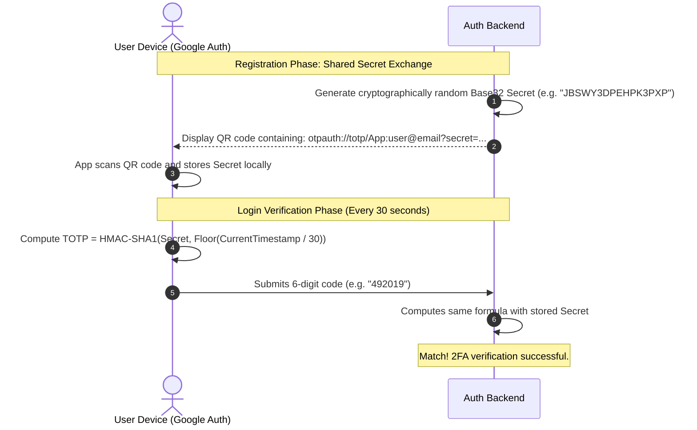

# Multi-Factor Authentication (TOTP 2FA) & Modern Password Hashing

In enterprise systems, password-only authentication is vulnerable to credential stuffing, phishing, and password reuse.

The industry-standard second factor is **TOTP (Time-Based One-Time Password - RFC 6238)**, compatible with apps like Google Authenticator, 1Password, and Authy.

---

## 1. How TOTP Works Under the Hood



---

## 2. Production Code: TOTP Implementation in Python (`pyotp`)

```python
import pyotp
import qrcode
import io
import base64

def generate_totp_secret() -> str:
    """Generates a random 32-character base32 secret."""
    return pyotp.random_base32()

def generate_qr_code_base64(secret: str, user_email: str) -> str:
    """Generates a QR code PNG data-URI that the frontend displays."""
    totp = pyotp.TOTP(secret)
    provisioning_uri = totp.provisioning_uri(name=user_email, issuer_name="AllInOneBackend")

    img = qrcode.make(provisioning_uri)
    buf = io.BytesIO()
    img.save(buf, format="PNG")
    b64_img = base64.b64encode(buf.getvalue()).decode()
    return f"data:image/png;base64,{b64_img}"

def verify_totp_code(secret: str, code: str) -> bool:
    """
    Verifies code. valid_window=1 allows a 30-second clock skew tolerance
    for mobile phones whose internal clocks are slightly drifted.
    """
    totp = pyotp.TOTP(secret)
    return totp.verify(code, valid_window=1)
```

---

## 3. Password Hashing: Argon2id (OWASP Recommendation)

While `bcrypt` is widely used, the official **OWASP Password Storage Cheat Sheet** recommends **Argon2id** as the modern winner of the Password Hashing Competition. It provides superior resistance against GPU and ASIC brute-forcing.

=== "Python Argon2id with `argon2-cffi`"
    ```python
    from argon2 import PasswordHasher
    from argon2.exceptions import VerifyMismatchError

    ph = PasswordHasher(
        time_cost=3,        # Iteration count
        memory_cost=65536,  # 64 MB of RAM required per hash attempt (kills GPUs!)
        parallelism=4,
    )

    # Hash password:
    hashed_pw = ph.hash("UserSuperSecretPassword123!")

    # Verify password:
    try:
        ph.verify(hashed_pw, "UserSuperSecretPassword123!")
        print("Password Match!")
    except VerifyMismatchError:
        print("Invalid Credentials.")
    ```

