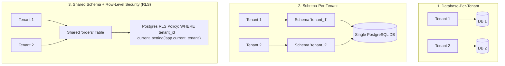

# Multi-Tenancy Architecture & Data Isolation (PostgreSQL RLS)

In B2B SaaS applications, multiple customer organizations (tenants) share the same application infrastructure.

A data leak where **Tenant A can view or modify Tenant B's data** is a company-ending security catastrophe.

---

## 1. Multi-Tenant Architectural Strategies



| Dimension | Database-per-Tenant | Schema-per-Tenant | Shared DB + Postgres RLS |
| :--- | :--- | :--- | :--- |
| **Data Isolation** | Maximum (Separate disks/DBs) | Strong (Separate schemas) | **Strong (Kernel/DB-enforced RLS)** |
| **Infrastructure Cost** | Very High | Medium | **Lowest (Shared resources)** |
| **Migration Complexity** | Extreme (Run migrations $N$ times) | High (Run migrations per schema) | **Lowest (Single migration run)** |
| **Max Tenants Supported** | Hundreds | A few thousand | **Unlimited** |

---

## 2. PostgreSQL Row-Level Security (RLS) Pattern

In traditional applications, developers rely on writing `filter(tenant_id=request.tenant_id)` in every single ORM query. If a junior developer forgets `.filter(tenant_id=...)` just once, **data leaks across tenants**.

**PostgreSQL Row-Level Security (RLS)** moves the isolation boundary directly into the database engine. Even if raw `SELECT * FROM orders;` is executed, the database returns **only the active tenant's rows**.

### Enabling RLS in PostgreSQL:
```sql
-- 1. Enable RLS on the table
ALTER TABLE orders ENABLE ROW LEVEL SECURITY;

-- 2. Create the policy
CREATE POLICY tenant_isolation_policy ON orders
    FOR ALL
    USING (tenant_id = NULLIF(current_setting('app.current_tenant', true), '')::uuid);
```

---

## 3. Production Code Implementations

=== "Django REST Framework (Tenant Context Middleware)"
    ```python
    from django.db import connection

    class TenantRLSMiddleware:
        """
        Injects the active tenant ID into the PostgreSQL connection session
        for every request before executing any queries.
        """
        def __init__(self, get_response):
            self.get_response = get_response

        def __call__(self, request):
            tenant_id = request.headers.get("X-Tenant-ID") or getattr(request.user, "tenant_id", None)

            if tenant_id:
                with connection.cursor() as cursor:
                    # Set session variable (scoped to current transaction/connection)
                    cursor.execute("SET LOCAL app.current_tenant = %s;", [str(tenant_id)])

            response = self.get_response(request)
            return response
    ```

=== "FastAPI (Async SQLAlchemy RLS Session Wrapper)"
    ```python
    from fastapi import Request, Depends
    from sqlalchemy.ext.asyncio import AsyncSession
    from sqlalchemy import text
    from app.core.database import AsyncSessionLocal

    async def get_tenant_db(request: Request) -> AsyncSession:
        tenant_id = request.headers.get("X-Tenant-ID")
        if not tenant_id:
            raise HTTPException(status_code=400, detail="Missing X-Tenant-ID header")

        async with AsyncSessionLocal() as session:
            # Set local postgres session variable
            await session.execute(
                text("SET LOCAL app.current_tenant = :tenant_id"),
                {"tenant_id": str(tenant_id)},
            )
            try:
                yield session
            finally:
                await session.close()
    ```

