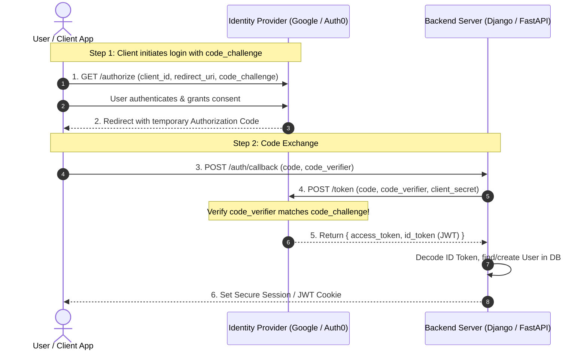

# OAuth 2.0 & OpenID Connect (OIDC) with PKCE

OAuth 2.0 is an **authorization framework** (delegating access to API resources without sharing passwords), while OpenID Connect (OIDC) is an **identity layer built on top of OAuth 2.0** to verify the user's identity.

In modern applications, the industry-standard flow for web and mobile clients is the **Authorization Code Grant with PKCE (Proof Key for Code Exchange)**.

---

## 1. The Authorization Code Flow with PKCE



* **Why PKCE is Mandatory**: In public clients (Single-Page Apps, React Native, iOS/Android apps), client secrets cannot be stored securely. PKCE generates a one-time cryptographic `code_verifier` and hashed `code_challenge` per request, preventing authorization code interception attacks.

---

## 2. Production Code: Google OAuth2 Callback in FastAPI

```python
import httpx
from fastapi import APIRouter, HTTPException, status
from pydantic import BaseModel

router = APIRouter(prefix="/auth/social", tags=["Social Auth"])

GOOGLE_TOKEN_URL = "https://oauth2.googleapis.com/token"
GOOGLE_USERINFO_URL = "https://www.googleapis.com/oauth2/v3/userinfo"

class GoogleCallbackPayload(BaseModel):
    code: str
    code_verifier: str
    redirect_uri: str

@router.post("/google/callback")
async def handle_google_login(payload: GoogleCallbackPayload):
    async with httpx.AsyncClient(timeout=5.0) as client:
        # 1. Exchange code for tokens
        token_resp = await client.post(
            GOOGLE_TOKEN_URL,
            data={
                "client_id": "YOUR_GOOGLE_CLIENT_ID",
                "client_secret": "YOUR_GOOGLE_CLIENT_SECRET",
                "code": payload.code,
                "code_verifier": payload.code_verifier,
                "grant_type": "authorization_code",
                "redirect_uri": payload.redirect_uri,
            },
        )
        if token_resp.status_code != 200:
            raise HTTPException(status_code=status.HTTP_400_BAD_REQUEST, detail="Failed to exchange code")

        token_data = token_resp.json()
        access_token = token_data["access_token"]

        # 2. Fetch authenticated user profile
        user_resp = await client.get(
            GOOGLE_USERINFO_URL,
            headers={"Authorization": f"Bearer {access_token}"},
        )
        user_info = user_resp.json()

        email = user_info["email"]
        google_id = user_info["sub"]

        # 3. Provision or login user in your database
        # user = await get_or_create_user(email=email, google_id=google_id)
        return {"status": "authenticated", "email": email}
```

