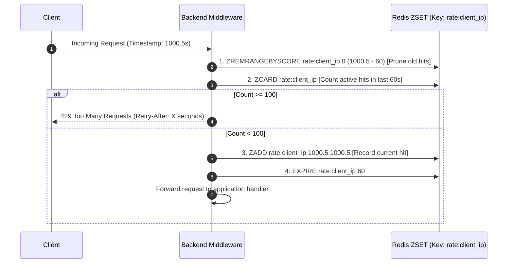

# Rate Limiting & OWASP Top 10 Defenses

Securing backend APIs against brute-force attacks, DDoS, credential stuffing, and OWASP Top 10 vulnerabilities is a mandatory production requirement.

---

## 1. Sliding Window Rate Limiting (Redis Sorted Sets)

Fixed-window rate limiters (e.g. "100 requests per clock minute") are vulnerable to **traffic bursts** at window boundaries: an attacker can send 100 requests at 00:59 and another 100 at 01:00, causing a 200-request burst within 2 seconds.

The **Sliding Window Log / Counter** using Redis Sorted Sets (`ZSET`) provides smooth, burst-resistant rate limiting.



---

## 2. Production Code Implementations

=== "Django REST Framework (Redis Sliding Window Rate Limiter)"
    ```python
    import time
    from django.core.cache import cache
    from rest_framework.throttling import BaseThrottle
    from django_redis import get_redis_connection

    class SlidingWindowThrottle(BaseThrottle):
        rate_limit = 100  # requests
        window_seconds = 60

        def allow_request(self, request, view):
            ident = self.get_ident(request)
            key = f"throttle:{ident}"
            now = time.time()
            window_start = now - self.window_seconds

            conn = get_redis_connection("default")
            pipe = conn.pipeline()

            # 1. Remove old timestamps outside current window
            pipe.zremrangebyscore(key, 0, window_start)
            # 2. Count timestamps in current window
            pipe.zcard(key)
            # 3. Add current timestamp
            pipe.zadd(key, {str(now): now})
            # 4. Set expiry
            pipe.expire(key, self.window_seconds)

            results = pipe.execute()
            request_count = results[1]

            if request_count >= self.rate_limit:
                return False  # Throttle -> returns 429
            return True
    ```

=== "FastAPI (Async Rate Limiter Dependency)"
    ```python
    import time
    from fastapi import Request, HTTPException, status, Depends
    from redis.asyncio import Redis
    from app.core.redis import get_redis

    class RateLimiter:
        def __init__(self, requests_per_minute: int = 60):
            self.limit = requests_per_minute
            self.window = 60

        async def __call__(self, request: Request, redis: Redis = Depends(get_redis)):
            client_ip = request.client.host
            key = f"ratelimit:{client_ip}"
            now = time.time()
            window_start = now - self.window

            pipe = redis.pipeline()
            pipe.zremrangebyscore(key, 0, window_start)
            pipe.zcard(key)
            pipe.zadd(key, {str(now): now})
            pipe.expire(key, self.window)
            results = await pipe.execute()

            current_count = results[1]
            if current_count >= self.limit:
                raise HTTPException(
                    status_code=status.HTTP_429_TOO_MANY_REQUESTS,
                    detail="Rate limit exceeded. Try again in 60 seconds.",
                    headers={"Retry-After": "60"},
                )
    ```

---

## 3. OWASP Top 10 Mitigation Summary

| OWASP Vulnerability | Attack Vector | Production Defense |
| :--- | :--- | :--- |
| **SQL Injection** | Unsanitized user inputs in queries | Use ORM parameterization. **Never format raw SQL with f-strings (`f"SELECT * WHERE id = {user_input}"`)**. |
| **SSRF** | Server makes requests to internal metadata IP (`169.254.169.254`) | Validate outgoing URLs; block private IP ranges (RFC 1918) via firewall. |
| **Broken Object Level Authorization (BOLA)** | User modifies ID in URL (`GET /orders/999`) to view other users' data | Always scope queries to `request.user.id` or active tenant. |
| **Security Misconfiguration** | Debug mode left active in production | Enforce `DEBUG = False` and strict CORS headers (`Access-Control-Allow-Origin`). |

