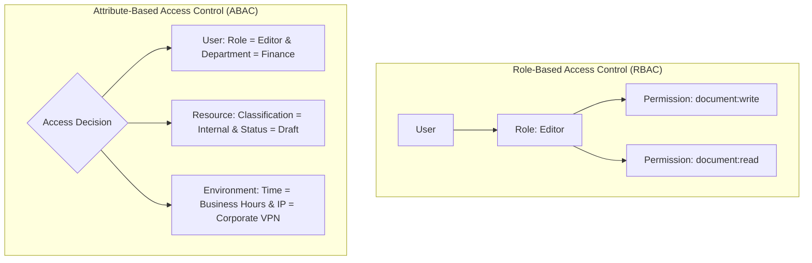

# Role-Based (RBAC) & Attribute-Based (ABAC) Access Control

Authentication verifies **who the user is** (`request.user`), but **Authorization** determines **what they are permitted to do**.

As applications scale from basic CRUD to enterprise B2B SaaS, hardcoding `if user.is_superuser` or `if user.role == "ADMIN"` results in unmaintainable spaghetti code.

---

## 1. Authorization Paradigms: RBAC vs. ABAC



* **RBAC**: Fast, predictable, and suitable for 90% of business operations (e.g. `billing:read`, `users:invite`).
* **ABAC**: Evaluates granular attributes on the fly (e.g., *"A manager can only approve expense reports if the expense belongs to their department and the amount is under \$5,000"*).

---

## 2. Production Code Implementations

=== "Django REST Framework (Granular Permission Classes)"
    ```python
    from rest_framework.permissions import BasePermission

    class HasPermission(BasePermission):
        """
        Dynamically checks if user's role has the required permission codename.
        """
        def __init__(self, required_permission: str):
            self.required_permission = required_permission

        def __call__(self):
            return self

        def has_permission(self, request, view):
            if not request.user or not request.user.is_authenticated:
                return False
            if request.user.is_superuser:
                return True
            # Cache or query user permissions from role
            user_perms = request.user.get_all_permissions()
            return self.required_permission in user_perms

    class IsOrganizationAdminOrOwner(BasePermission):
        """
        Object-level ABAC permission.
        """
        def has_object_permission(self, request, view, obj):
            # Safe read methods (GET, HEAD, OPTIONS)
            if request.method in ["GET", "HEAD", "OPTIONS"]:
                return True
            # Write operations require being owner or admin of that org
            return obj.owner_id == request.user.id or request.user.org_role == "ADMIN"
    ```

=== "FastAPI (Composable Security Dependency)"
    ```python
    from typing import Annotated
    from fastapi import Depends, HTTPException, status
    from app.core.auth import get_current_user
    from app.models.user import User

    class RequirePermission:
        def __init__(self, permission: str):
            self.permission = permission

        async def __call__(self, current_user: User = Depends(get_current_user)) -> User:
            if current_user.is_superuser:
                return current_user

            if self.permission not in current_user.cached_permissions:
                raise HTTPException(
                    status_code=status.HTTP_403_FORBIDDEN,
                    detail=f"Missing required permission: '{self.permission}'",
                )
            return current_user

    # In Route:
    from fastapi import APIRouter
    router = APIRouter()

    @router.delete("/projects/{project_id}")
    async def delete_project(
        project_id: int,
        user: Annotated[User, Depends(RequirePermission("projects:delete"))],
    ):
        return {"status": "deleted"}
    ```

---

## 3. Production Best Practices
- **Check Permissions at the Service/Selector Layer, Not Just the View**: If a background Celery task or batch job triggers a business action, the authorization rules must still be enforced.
- **Fail Closed**: Default to denying access unless an explicit permission allows it.

