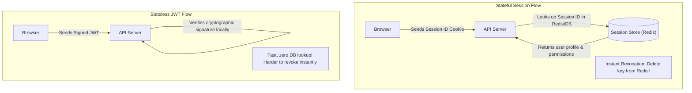

# Cookie Security, Stateful Sessions & CSRF Defenses

When authenticating web applications, developers frequently face the dilemma: **Server-Side Stateful Sessions** vs. **Client-Side Stateless Tokens (JWTs)**.

---

## 1. Architectural Comparison



| Dimension | Stateful Sessions (Django / Redis) | Stateless JWTs |
| :--- | :--- | :--- |
| **Revocation** | **Instant**: Delete session from Redis/DB | Requires token blacklist or token rotation family |
| **Server Memory** | Consumes Redis/DB storage per active session | Zero storage on server |
| **Best For** | Browser-heavy B2B SaaS, Admin portals | High-scale microservices, mobile APIs, federated auth |

---

## 2. The 4 Mandatory Cookie Security Flags

If storing session IDs or JWTs in cookies, **always set these 4 flags**:

```http
Set-Cookie: auth_token=xyz987; HttpOnly; Secure; SameSite=Strict; Path=/
```

1. **`HttpOnly`**: **Prevents XSS theft**. JavaScript (`document.cookie`) cannot read the cookie under any circumstances.
2. **`Secure`**: Enforces that the cookie is transmitted **only over encrypted HTTPS connections**.
3. **`SameSite=Strict` (or `Lax`)**: **Prevents CSRF attacks**. The browser refuses to send the cookie on cross-site requests initiated by third-party malicious websites.
4. **`Path=/`**: Restricts the cookie scope across your domain.

---

## 3. Production Code Implementations

=== "FastAPI: Setting Secure Auth Cookies"
    ```python
    from fastapi import FastAPI, Response, status

    app = FastAPI()

    @app.post("/auth/login")
    def login_endpoint(response: Response):
        token = generate_session_token()

        response.set_cookie(
            key="auth_token",
            value=token,
            httponly=True,        # Blocks XSS access
            secure=True,          # HTTPS only
            samesite="lax",       # Mitigates CSRF
            max_age=86400 * 7,    # 7 days
            path="/",
        )
        return {"status": "success"}

    @app.post("/auth/logout")
    def logout_endpoint(response: Response):
        response.delete_cookie(key="auth_token", path="/")
        return {"status": "logged_out"}
    ```

=== "Django REST Framework: Enforcing CSRF Protection"
    In `settings.py`:
    ```python
    SESSION_COOKIE_HTTPONLY = True
    SESSION_COOKIE_SECURE = True
    SESSION_COOKIE_SAMESITE = "Lax"

    CSRF_COOKIE_HTTPONLY = False  # Frontend needs to read CSRF token to send in X-CSRFToken header
    CSRF_COOKIE_SECURE = True
    CSRF_COOKIE_SAMESITE = "Lax"
    ```

