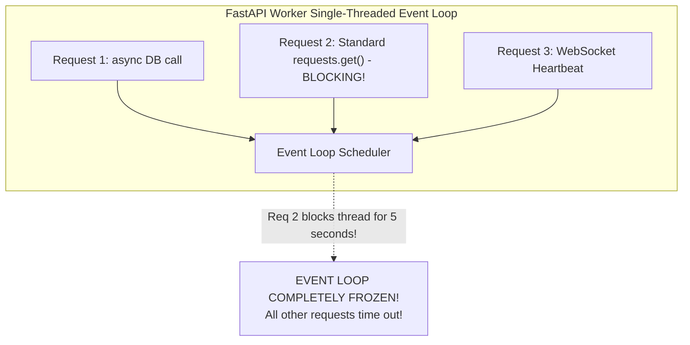

# Async Event Loop Pitfalls & Performance Profiling

FastAPI's high throughput is enabled by its **Single-Threaded Asynchronous Event Loop** (powered by `asyncio` and `uvloop`).

However, writing asynchronous Python requires strict discipline. A single blocking synchronous call inside an `async def` function will freeze the entire event loop, stopping all other incoming client requests across the worker.

---

## 1. The Event Loop Starvation Hazard



### The Cardinal Rule of Async Python:
> **Never call synchronous blocking I/O (e.g. `requests.get()`, `time.sleep()`, standard synchronous Django ORM queries) directly inside an `async def` route without offloading to a thread pool.**

---

## 2. Offloading Blocking Calls Safely

If you must execute synchronous or CPU-intensive code (e.g. image resizing with Pillow, PDF generation, or legacy synchronous libraries):

=== "FastAPI (`asyncio.to_thread`)"
    ```python
    import asyncio
    import requests
    from fastapi import APIRouter

    router = APIRouter()

    def blocking_sync_call(url: str) -> dict:
        # Synchronous, blocking HTTP call
        response = requests.get(url, timeout=5)
        return response.json()

    @router.get("/safe-sync-fetch")
    async def safe_fetch_endpoint():
        # Offloads the blocking function to Python's internal thread pool
        # The main async event loop remains 100% responsive to other users!
        data = await asyncio.to_thread(blocking_sync_call, "https://api.external.com/data")
        return {"data": data}
    ```

    > **FastAPI Secret**: If you define your endpoint with plain `def endpoint():` instead of `async def endpoint():`, FastAPI automatically runs it inside a separate thread pool for you!

=== "Django (`sync_to_async` & `async_to_sync`)"
    ```python
    from asgiref.sync import sync_to_async
    from myapp.models import User

    # Wrap synchronous Django ORM operations
    @sync_to_async
    def get_user_async(user_id: int):
        return User.objects.select_related("profile").get(id=user_id)

    # In async context / Channels / Async Views:
    user = await get_user_async(user_id=123)
    ```

---

## 3. Production Profiling Tools

1. **`py-spy`**: Zero-overhead sampling profiler for production Python servers. Generates interactive FlameGraphs without restarting or modifying running code:
   ```bash
   py-spy record -o profile.svg --pid 12345
   ```
2. **`cProfile` & `SnakeViz`**: Deterministic function-level profiling in development:
   ```bash
   python -m cProfile -o app.prof manage.py runserver
   snakeviz app.prof
   ```
3. **Database Query Profiling**: Always verify query plan execution time via `EXPLAIN (ANALYZE, BUFFERS)` rather than relying purely on client-side measurements.

