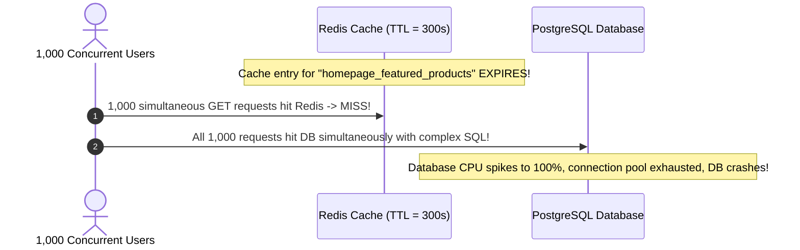
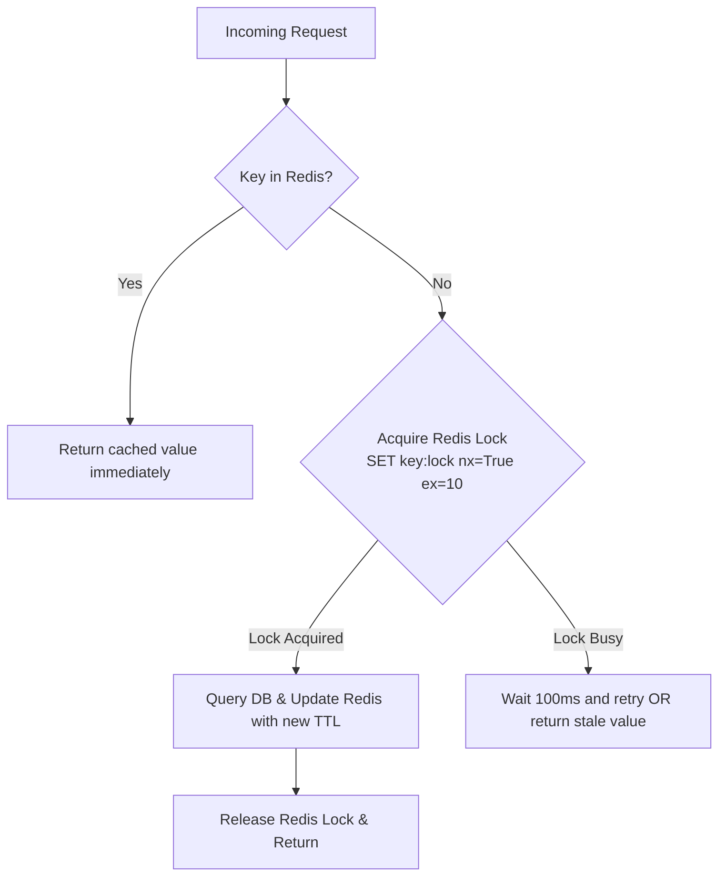

# Redis Caching Patterns & Stampede (Dogpiling) Prevention

In-memory caching with Redis delivers sub-millisecond response times, relieving PostgreSQL from expensive repetitive queries.

However, naive caching introduces severe production traps: **Cache Stampede (Dogpiling)**, **Stale Data Inconsistency**, and **Redis Memory Eviction crashes**.

---

## 1. The Cache Stampede Problem



When a high-traffic cached key expires, thousands of concurrent requests observe a cache miss at the exact same millisecond. They all stampede the primary database to recalculate the same value.

---

## 2. Preventing Cache Stampede: Mutex Locking

When a cache miss occurs, only **one single worker** is allowed to acquire a distributed mutex lock in Redis to recompute the value from the database. All other incoming requests either wait or return a slightly stale value gracefully.



---

## 3. Production Code Implementations

=== "Django REST Framework (Cache-Aside with Mutex Lock)"
    ```python
    import json
    import time
    from django.core.cache import cache
    from django_redis import get_redis_connection
    from myapp.models import Product

    def get_featured_products_safe():
        cache_key = "products:featured:v1"
        lock_key = "lock:products:featured:v1"

        cached = cache.get(cache_key)
        if cached is not None:
            return cached

        # Attempt to acquire distributed lock (10s expiry to prevent deadlock)
        conn = get_redis_connection("default")
        acquired = conn.set(lock_key, "locked", nx=True, ex=10)

        if acquired:
            try:
                # Re-check cache in case another worker just filled it
                cached = cache.get(cache_key)
                if cached is not None:
                    return cached

                # Query database
                data = list(Product.objects.filter(is_featured=True).values("id", "name", "price"))
                cache.set(cache_key, data, timeout=600)  # 10 minutes
                return data
            finally:
                conn.delete(lock_key)
        else:
            # Another worker is already recalculating -> wait briefly and re-read
            time.sleep(0.15)
            return cache.get(cache_key) or []
    ```

=== "FastAPI (Async Cache-Aside with Redis)"
    ```python
    import json
    import asyncio
    from redis.asyncio import Redis
    from sqlalchemy.ext.asyncio import AsyncSession
    from sqlalchemy import select
    from app.models.product import Product

    async def get_featured_products_async(redis: Redis, db: AsyncSession):
        cache_key = "products:featured:async:v1"
        lock_key = "lock:products:featured:async:v1"

        raw_cached = await redis.get(cache_key)
        if raw_cached:
            return json.loads(raw_cached)

        # Acquire Redis lock with SET NX EX
        acquired = await redis.set(lock_key, "1", nx=True, ex=10)
        if acquired:
            try:
                stmt = select(Product).where(Product.is_featured == True)
                result = await db.execute(stmt)
                products = result.scalars().all()
                serialized = [{"id": p.id, "name": p.name, "price": float(p.price)} for p in products]

                await redis.set(cache_key, json.dumps(serialized), ex=600)
                return serialized
            finally:
                await redis.delete(lock_key)
        else:
            await asyncio.sleep(0.15)
            raw = await redis.get(cache_key)
            return json.loads(raw) if raw else []
    ```

---

## 4. Cache Invalidation Best Practices
* **Don't Over-Invalidate**: Use versioned keys (`user:profile:v2:{user_id}`) so breaking schema changes can be deployed without corrupting old cache formats.
* **Tag-Based Invalidation**: Store sets of associated keys in Redis so that updating an organization invalidates all related member listings in a single atomic pipelined command.

