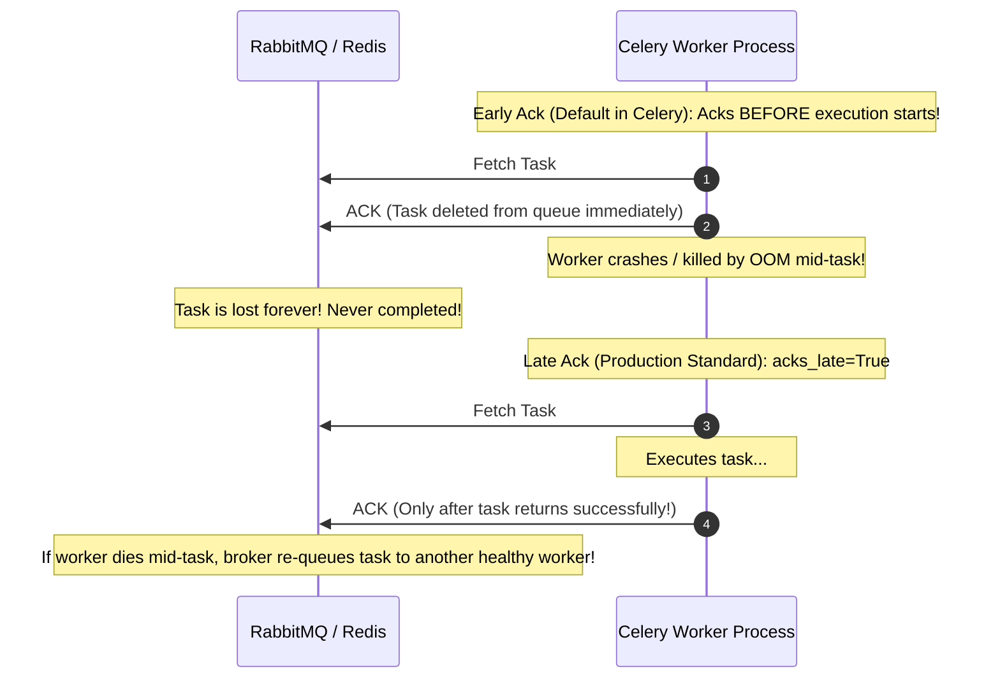
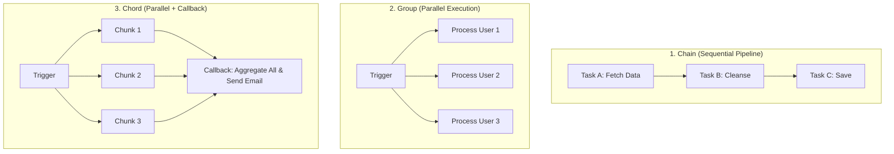

# Celery Orchestration, Late Ack & Task Idempotency

Background task queues (Celery, ARQ, BullMQ) offload long-running operations (emails, PDF rendering, external syncs, batch data imports) outside the client request-response lifecycle.

However, in production, worker nodes get killed by out-of-memory (OOM) managers, deployments restart containers, and network blips drop broker connections. Without proper configuration, tasks are lost forever or executed twice.

---

## 1. Early Ack vs. Late Acknowledgment



---

## 2. Celery Production Settings

```python
# celery_config.py
task_acks_late = True                    # Only ack after completion
task_reject_on_worker_lost = True        # Re-queue task if worker process dies abruptly
worker_prefetch_multiplier = 1           # Workers fetch 1 task at a time (prevents hogging)
worker_cancel_long_running_tasks_on_connection_loss = True
task_time_limit = 1800                   # Hard kill after 30 mins
task_soft_time_limit = 1500              # Soft timeout after 25 mins (allows clean cleanup)
```

---

## 3. Celery Canvas Patterns (Chains, Groups, Chords)



=== "Production Code Implementation"
    ```python
    from celery import shared_task, chain, group, chord

    @shared_task(bind=True, max_retries=3, acks_late=True)
    def generate_user_report(self, user_id: int):
        try:
            # Task logic
            return f"Report for user {user_id} generated"
        except TransientNetworkError as exc:
            # Exponential backoff retry
            raise self.retry(exc=exc, countdown=2 ** self.request.retries)

    @shared_task
    def aggregate_reports(report_results: list[str], admin_email: str):
        # Callback receiving array of results from all parallel workers
        total_reports = len(report_results)
        # Dispatch notification
        return f"Aggregated {total_reports} reports"

    def run_monthly_report_pipeline(user_ids: list[int], admin_email: str):
        # Chord: Run all user reports in parallel, then invoke aggregate_reports
        header = group(generate_user_report.s(uid) for uid in user_ids)
        callback = aggregate_reports.s(admin_email=admin_email)
        return chord(header)(callback)
    ```

---

## 4. Task Idempotency: Redis Deduplication Lock
Because `acks_late=True` can re-queue a task if a worker crashes right at the end, **every task must be idempotent**.

```python
@shared_task(bind=True)
def send_order_receipt(self, order_id: int):
    lock_key = f"task_lock:receipt:{order_id}"
    conn = get_redis_connection("default")

    # Acquire deduplication key for 2 hours
    if not conn.set(lock_key, "running", nx=True, ex=7200):
        logger.warning(f"Task for order {order_id} already executed or running. Skipping.")
        return

    # Send receipt email...
```

