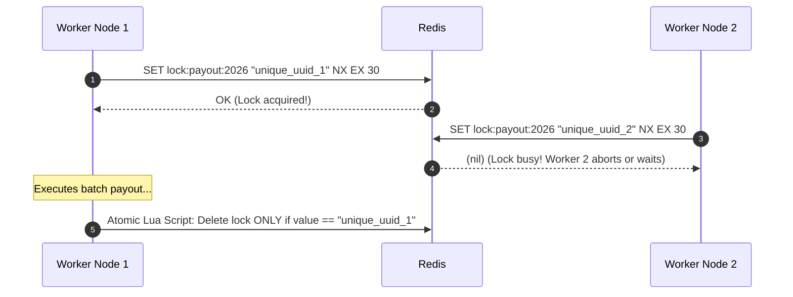
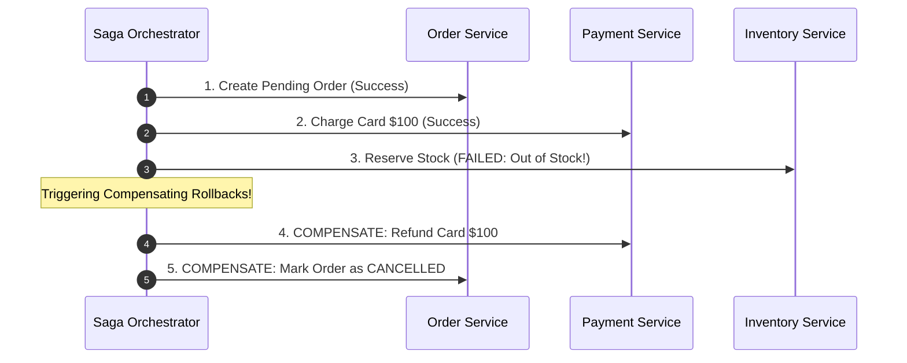

# Distributed Locks (Redlock) & The Saga Pattern

In distributed microservices, standard database transactions cannot span across independent database boundaries. 

Two critical patterns solve this:
1. **Distributed Locks**: Coordinating access to shared resources across multiple API server instances.
2. **The Saga Pattern**: Executing multi-step business transactions across distributed services with automated compensating rollbacks.

---

## 1. Distributed Locking with Redis (Redlock & Fencing Tokens)

To prevent two worker instances from running the same scheduled cron job or billing the same customer at once:



### The Critical Safe Release Lua Script:
Never use plain `redis.delete(key)` to release a lock! If Worker 1 ran slowly and its lock expired, a naive delete will accidentally delete Worker 2's new lock! Use an atomic Lua script:

```lua
if redis.call("get", KEYS[1]) == ARGV[1] then
    return redis.call("del", KEYS[1])
else
    return 0
end
```

---

## 2. The Saga Pattern & Compensating Transactions

Suppose a customer checks out:
1. **Order Service**: Creates order.
2. **Payment Service**: Charges credit card.
3. **Inventory Service**: Deducts warehouse stock.

If **Step 3 (Inventory) fails** because the item is out of stock, how do we rollback Step 2 (Payment)? We cannot execute an SQL `ROLLBACK` on an external credit card!

The solution is a **Compensating Transaction**: an explicit business action that undoes the forward step (e.g., executing a **Refund**).



