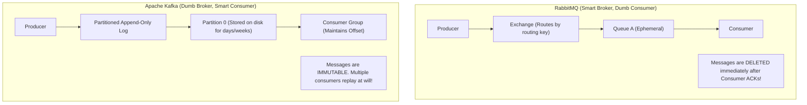

# Message Brokers: RabbitMQ vs. Apache Kafka

Both RabbitMQ and Apache Kafka pass messages asynchronously between backend services, but their internal architectures and guarantees are completely different.

---

## 1. Architectural Philosophy: Queue vs. Log

| Dimension | RabbitMQ | Apache Kafka |
| :--- | :--- | :--- |
| **Data Model** | Ephemeral Queue (Deleted after ACK) | Append-Only Distributed Commit Log (Retained on disk) |
| **Routing Flexibility** | **Extreme** (Topic, Direct, Fanout, Header exchanges) | Fixed (Topic partitions based on hash key) |
| **Event Replay** | Not supported | **Native**: Consumers can rewind offset and reprocess |
| **Throughput** | ~50,000 messages/sec | **Millions of events/sec** (Batched I/O) |
| **Best Used For** | Background worker tasks, priority queues, complex routing | Event sourcing, CDC, audit streaming, telemetry, real-time analytics |

---

## 2. RabbitMQ Exchange Routing Types

1. **Direct Exchange**: Routes message to queues matching exact `routing_key` (e.g. `orders.created`).
2. **Fanout Exchange**: Broadcasts message to **all bound queues** regardless of routing key (pub/sub).
3. **Topic Exchange**: Wildcard pattern matching (`orders.*` or `orders.eu.#`).

---

## 3. Kafka Partitions & Consumer Groups

In Kafka, a Topic is divided into multiple **Partitions** distributed across broker machines:
* **Ordering Guarantee**: Messages are strictly ordered **within a single partition**, but not across different partitions!
* **Partition Key**: Always publish with a deterministic key (e.g. `order_id` or `user_id`) so all events for that specific entity land in the same partition and are processed in strict chronological order.

