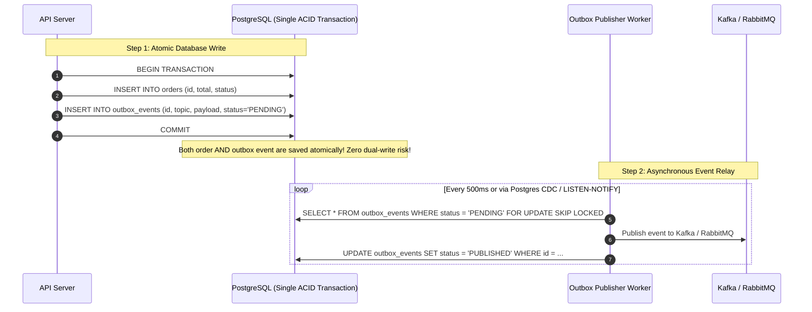

# The Transactional Outbox Pattern: Eliminating Dual-Write Hazards

A classic disaster in distributed systems and backend engineering is the **Dual-Write Problem**:

```python
# NAIVE BAD PATTERN:
with transaction.atomic():
    order = Order.objects.create(...)
    # If the database commit succeeds, but Redis/Kafka is temporarily down:
    # Event is lost! Downstream services never know order was placed.
    
    # OR: If the message publishes, but the DB rollback occurs:
    # Ghost event published for an order that does not exist in DB!
    kafka_producer.send("orders", payload)
```

You cannot span an ACID transaction across both an SQL database and an external message broker (Redis, RabbitMQ, Kafka) without distributed 2-Phase Commit (which is brittle and slow).

---

## 1. The Outbox Architecture



---

## 2. Production Code Implementations

=== "Django REST Framework (Outbox Pattern)"
    ```python
    import json
    import uuid
    from django.db import models, transaction
    from myapp.models import Order

    class OutboxEvent(models.Model):
        id = models.UUIDField(primary_key=True, default=uuid.uuid4)
        topic = models.CharField(max_length=128, db_index=True)
        payload = models.JSONField()
        status = models.CharField(
            max_length=32,
            choices=[("PENDING", "Pending"), ("PUBLISHED", "Published"), ("FAILED", "Failed")],
            default="PENDING",
            db_index=True,
        )
        created_at = models.DateTimeField(auto_now_add=True, db_index=True)

    def create_order_with_outbox(*, user_id: int, total_amount: float) -> Order:
        with transaction.atomic():
            # 1. Create Order
            order = Order.objects.create(user_id=user_id, total_amount=total_amount)

            # 2. Write Outbox Event within the exact same transaction
            OutboxEvent.objects.create(
                topic="order.created",
                payload={"order_id": order.id, "user_id": user_id, "amount": str(total_amount)},
            )
            return order
    ```

    ```python
    # Management command / Relay worker
    from django.core.management.base import BaseCommand
    from myapp.models import OutboxEvent

    class Command(BaseCommand):
        def handle(self, *args, **options):
            # Query pending events using SKIP LOCKED to support parallel workers
            with transaction.atomic():
                events = (
                    OutboxEvent.objects
                    .select_for_update(skip_locked=True)
                    .filter(status="PENDING")[:100]
                )
                for event in events:
                    # Publish to Kafka / RabbitMQ
                    publish_to_broker(topic=event.topic, payload=event.payload)
                    event.status = "PUBLISHED"
                    event.save(update_fields=["status"])
    ```

=== "FastAPI + SQLAlchemy 2.0 Async"
    ```python
    import uuid
    from sqlalchemy import Column, String, DateTime, text
    from sqlalchemy.dialects.postgresql import UUID, JSONB
    from sqlalchemy.ext.asyncio import AsyncSession
    from app.core.database import Base

    class OutboxEvent(Base):
        __tablename__ = "outbox_events"

        id = Column(UUID(as_uuid=True), primary_key=True, default=uuid.uuid4)
        topic = Column(String(128), nullable=False, index=True)
        payload = Column(JSONB, nullable=False)
        status = Column(String(32), default="PENDING", index=True)
        created_at = Column(DateTime(timezone=True), server_default=text("now()"))

    async def create_order_outbox(db: AsyncSession, user_id: int, amount: float):
        async with db.begin():
            # Create Order
            order = Order(user_id=user_id, total_amount=amount)
            db.add(order)
            await db.flush()

            # Create Outbox Event
            event = OutboxEvent(
                topic="orders.created",
                payload={"order_id": order.id, "user_id": user_id, "amount": amount},
            )
            db.add(event)
            # Transaction commits both atomically!
    ```

---

## 3. Alternative: Change Data Capture (CDC) with Debezium
Instead of a custom polling worker, high-scale enterprises attach **Debezium** directly to PostgreSQL's Write-Ahead Log (**WAL**). Debezium automatically streams every committed row in `outbox_events` directly into Kafka topics with zero polling overhead.

