# Distributed Tracing with OpenTelemetry & Prometheus Metrics

When a user complains that an API endpoint takes 4.5 seconds to load, where is the bottleneck?
* Was it PostgreSQL executing a slow query?
* Was it Redis waiting on a lock?
* Was it an external third-party API call?
* Was it Python CPU computation?

**OpenTelemetry (OTel)** provides distributed tracing by breaking every request down into a hierarchical tree of **Spans**.

---

## 1. Trace Hierarchy Visualization

```mermaid
gantt
    title Request Trace: POST /api/v1/orders/checkout (Total: 450ms)
    dateFormat X
    axisFormat %s ms

    section HTTP View
    FastAPI Router Checkout : 0, 450

    section Database
    PostgreSQL SELECT Wallet FOR UPDATE : 10, 60
    PostgreSQL INSERT Order : 60, 90

    section External APIs
    Stripe Payment Charge API : 90, 380

    section Queue
    Redis LPUSH Outbox Event : 380, 410
```



With OpenTelemetry, you see exact millisecond timings for every SQL query, external HTTP request, and cache read.

---

## 2. OpenTelemetry Auto-Instrumentation

In production, Python applications are auto-instrumented using standard OpenTelemetry SDKs:

```bash
pip install opentelemetry-distro opentelemetry-exporter-otlp
opentelemetry-bootstrap -a install
```

When running Gunicorn or Uvicorn:
```bash
opentelemetry-instrument \
    --traces_exporter otlp \
    --metrics_exporter prometheus \
    --service_name production-backend-api \
    uvicorn app.main:app --host 0.0.0.0 --port 8000
```

---

## 3. Prometheus Metrics: The 4 Golden Signals

Every production service should expose a `/metrics` endpoint scraped by Prometheus tracking Google's **4 Golden Signals**:

1. **Latency**: Duration of requests (Histogram: `http_request_duration_seconds_bucket`).
2. **Traffic**: Requests per second (Counter: `http_requests_total`).
3. **Errors**: Failed requests (Counter: `http_requests_total{status=~"5.."}`).
4. **Saturation**: Utilization of server resources (CPU, RAM, DB connection pool saturation).

=== "FastAPI Prometheus Export (`prometheus-fastapi-instrumentator`)"
    ```python
    from fastapi import FastAPI
    from prometheus_fastapi_instrumentator import Instrumentator

    app = FastAPI()

    # Automatically instrument all routes with latency and status counters
    instrumentator = Instrumentator().instrument(app)

    @app.on_event("startup")
    async def _startup():
        # Exposes /metrics endpoint for Prometheus scrapers
        instrumentator.expose(app, endpoint="/metrics")
    ```

