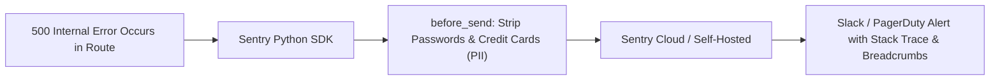

# Error Tracking & Exception Monitoring with Sentry

When an unhandled 500 error crashes a request in production, your users should not have to report it to support. Your engineering team should be notified in Slack with the exact line of code, user ID, stack trace, and request payload within seconds.

---

## 1. Sentry Integration Architecture



---

## 2. Production Code Implementations

=== "FastAPI (Sentry SDK with Tracing)"
    ```python
    import sentry_sdk
    from fastapi import FastAPI, Request

    sentry_sdk.init(
        dsn="https://your_public_key@sentry.io/123456",
        environment="production",
        release="backend@1.2.0",
        traces_sample_rate=0.1, # Trace 10% of requests for performance monitoring
        profiles_sample_rate=0.05,
        send_default_pii=False, # Don't send sensitive headers
    )

    app = FastAPI()

    # In middleware: attach user and correlation context to Sentry
    @app.middleware("http")
    async def sentry_context_middleware(request: Request, call_next):
        with sentry_sdk.configure_scope() as scope:
            scope.set_tag("correlation_id", getattr(request.state, "correlation_id", "unknown"))
            # If user authenticated:
            if hasattr(request.state, "user"):
                scope.set_user({"id": request.state.user.id, "email": request.state.user.email})

        return await call_next(request)
    ```

=== "Django REST Framework (Sentry DjangoIntegration)"
    In `settings.py`:
    ```python
    import sentry_sdk
    from sentry_sdk.integrations.django import DjangoIntegration

    sentry_sdk.init(
        dsn=os.environ.get("SENTRY_DSN"),
        integrations=[DjangoIntegration()],
        environment=os.environ.get("ENVIRONMENT", "production"),
        traces_sample_rate=0.1,
        send_default_pii=False,
    )
    ```

---

## 3. Scrubbing Sensitive PII (`before_send`)
```python
def strip_sensitive_data(event, hint):
    # Scrub auth tokens from request headers before sending to Sentry
    if "request" in event and "headers" in event["request"]:
        headers = event["request"]["headers"]
        if "authorization" in headers:
            headers["authorization"] = "[REDACTED]"
    return event

sentry_sdk.init(
    ...
    before_send=strip_sensitive_data,
)
```

