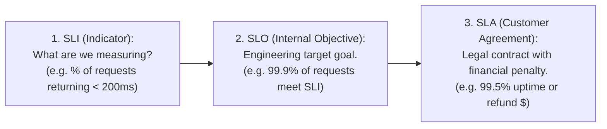

# SRE Reliability, RTO/RPO & Incident Runbooks

When an outage occurs at 3:00 AM, engineers should not have to guess what commands to run. A mature engineering organization maintains **Service Level Objectives (SLOs)**, **Disaster Recovery targets (RTO/RPO)**, and **Step-by-Step Production Runbooks**.

---

## 1. SLI, SLO & SLA Explained Simply



---

## 2. Disaster Recovery: RTO vs. RPO

* **RTO (Recovery Time Objective)**: How long can the system be down before business is critically impacted?
  * *Example*: RTO = 30 minutes $\rightarrow$ You must be able to restore the database and spin up healthy containers within 30 minutes.
* **RPO (Recovery Point Objective)**: How much data loss can the business tolerate measured in time?
  * *Example*: RPO = 5 minutes $\rightarrow$ You must stream Write-Ahead Logs (WAL) to S3 every 5 minutes so no more than 5 minutes of data can ever be lost.

---

## 3. Production Incident Runbook Template

Every critical operational alert (e.g. `HighDatabaseConnectionsAlert`) should link directly to a runbook:

```markdown
# Runbook: High Database Connection Spike (PgBouncer Exhaustion)

### 1. Alert Summary
Triggered when active PostgreSQL connections exceed 85% of max_connections for > 2 minutes.

### 2. Immediate Diagnostic Steps
1. SSH to primary bastion or run via psql:
   ```sql
   SELECT pid, age(clock_timestamp(), query_start), usename, query, state 
   FROM pg_stat_activity 
   WHERE state != 'idle' 
   ORDER BY query_start ASC LIMIT 10;
   ```
2. Identify hanging queries or unindexed table scans holding locks.

### 3. Immediate Mitigation
1. Terminate runaway hanging queries:
   ```sql
   SELECT pg_terminate_backend(pid);
   ```
2. Restart PgBouncer pooler or scale up web worker connection recycling (`max_requests=5000`).

### 4. Post-Mortem Action Items
* Add index to the offending query.
* Add statement timeout (`statement_timeout = '5s'`) to prevent future queries from hanging indefinitely.
```

