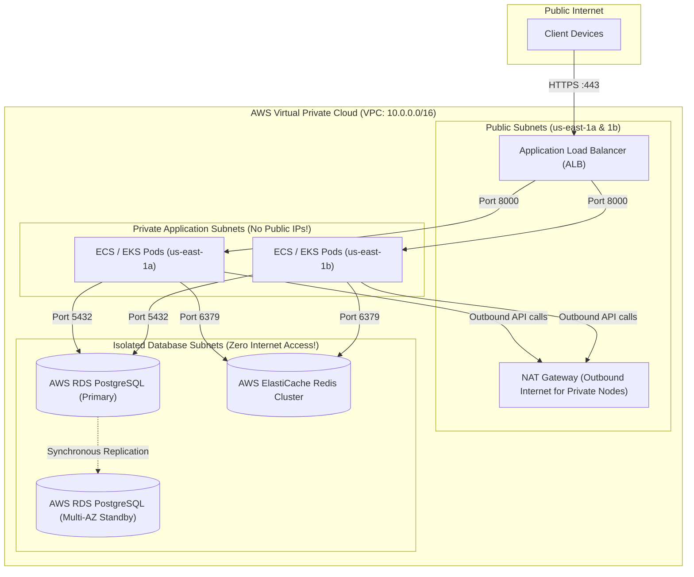

# AWS Cloud Infrastructure for Backend Engineers

A backend developer must understand how cloud infrastructure is architected to ensure network security, database isolation, and high availability.

---

## 1. Production AWS Network Topology (VPC & Subnets)

---

## 2. Security Group Chaining (Least Privilege)

Never open database ports (`5432`) to `0.0.0.0/0`! Use **Security Group Chaining**:

1. **ALB Security Group**:
   * Inbound: Port `80` & `443` from `0.0.0.0/0` (Entire internet).
2. **Application (ECS/EC2) Security Group**:
   * Inbound: Port `8000` **ONLY from `sg-alb`**.
3. **Database (RDS) Security Group**:
   * Inbound: Port `5432` **ONLY from `sg-app`**.
   * Outbound: None.

Even if an attacker gains the database password, they cannot connect over the internet because the database subnet has zero public routing!

