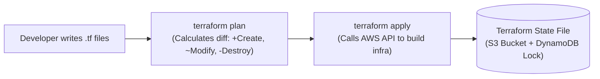

# Infrastructure as Code (IaC) with Terraform

Manually clicking through the AWS/GCP web console to create databases, subnets, and load balancers is error-prone, untracked, and impossible to reproduce when spinning up staging environments.

**Terraform** allows backend teams to declare infrastructure in version-controlled configuration files (`.tf`).

---

## 1. How Terraform Works



---

## 2. Production Terraform Module: AWS RDS PostgreSQL

```hcl
# rds.tf
resource "aws_db_instance" "production_postgres" {
  identifier        = "prod-postgres-db"
  engine            = "postgres"
  engine_version    = "16.2"
  instance_class    = "db.r6g.large" # 2 vCPU, 16 GB RAM
  allocated_storage = 100            # 100 GB Auto-scaling SSD
  max_allocated_storage = 1000       # Auto-scale up to 1 TB

  db_name  = "production_db"
  username = "app_master_user"
  password = var.db_password # Injected from AWS Secrets Manager

  # Multi-AZ High Availability (Automatic failover to standby in another datacenter)
  multi_az               = true
  publicly_accessible    = false
  db_subnet_group_name   = aws_db_subnet_group.private_db_subnets.name
  vpc_security_group_ids = [aws_security_group.db_sg.id]

  # Automated Backups
  backup_retention_period = 30 # Retain backups for 30 days
  backup_window           = "03:00-04:00"

  # Performance Insights & Monitoring
  performance_insights_enabled = true
  deletion_protection          = true # Prevents accidental terraform destroy!
}
```

---

## 3. Remote State & Locking
Always store `terraform.tfstate` in an **Amazon S3 bucket with versioning enabled**, and configure a **DynamoDB table for state locking** so two engineers cannot run `terraform apply` concurrently.

