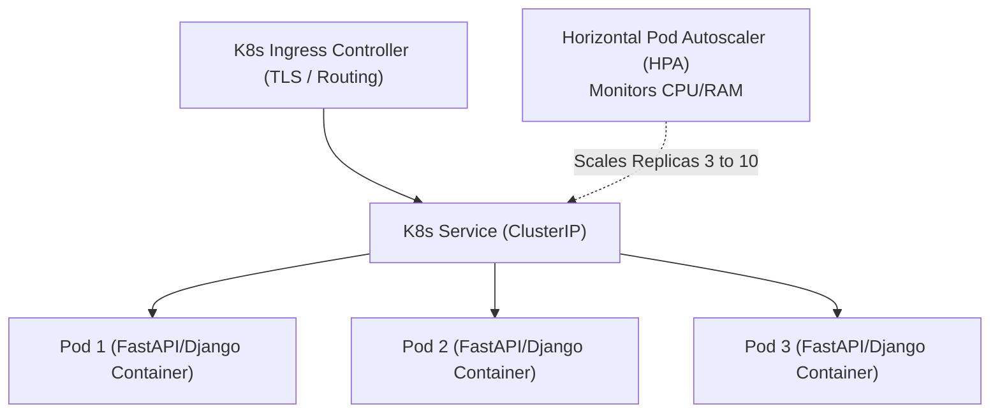

# Kubernetes for Backend Engineers: Deployments, Probes & HPA

When containerized backend applications scale past single virtual machines, **Kubernetes (K8s)** orchestrates container lifecycles, load balancing, secret injection, and automatic scaling.

---

## 1. Core Kubernetes Architecture



---

## 2. Production Deployment YAML (`deployment.yaml`)

```yaml
apiVersion: apps/v1
kind: Deployment
metadata:
  name: backend-api
  namespace: production
  labels:
    app: backend-api
spec:
  replicas: 3
  selector:
    matchLabels:
      app: backend-api
  strategy:
    type: RollingUpdate
    rollingUpdate:
      maxSurge: 1        # Spin up 1 new pod before killing an old one
      maxUnavailable: 0  # Zero downtime!
  template:
    metadata:
      labels:
        app: backend-api
    spec:
      containers:
        - name: api
          image: 123456789.dkr.ecr.us-east-1.amazonaws.com/backend:v1.2.0
          imagePullPolicy: IfNotPresent
          ports:
            - containerPort: 8000
          # 1. Resource Limits (Prevents runaway containers from crashing nodes)
          resources:
            requests:
              cpu: "250m"       # 0.25 CPU core
              memory: "512Mi"   # 512 MB RAM
            limits:
              cpu: "1000m"      # 1 CPU core max
              memory: "1Gi"     # 1 GB RAM max
          # 2. Environment Variables & Secrets
          envFrom:
            - configMapRef:
                name: backend-config
            - secretRef:
                name: backend-secrets
          # 3. Liveness & Readiness Probes
          readinessProbe:
            httpGet:
              path: /health/ready
              port: 8000
            initialDelaySeconds: 5
            periodSeconds: 10
          livenessProbe:
            httpGet:
              path: /health/live
              port: 8000
            initialDelaySeconds: 15
            periodSeconds: 20
```

---

## 3. Horizontal Pod Autoscaler (HPA)

Automatically scales your pod count up during traffic spikes and down at night:

```yaml
apiVersion: autoscaling/v2
kind: HorizontalPodAutoscaler
metadata:
  name: backend-api-hpa
  namespace: production
spec:
  scaleTargetRef:
    apiVersion: apps/v1
    kind: Deployment
    name: backend-api
  minReplicas: 3
  maxReplicas: 15
  metrics:
    - type: Resource
      resource:
        name: cpu
        target:
          type: Utilization
          averageUtilization: 70  # Scale when CPU reaches 70%
```

