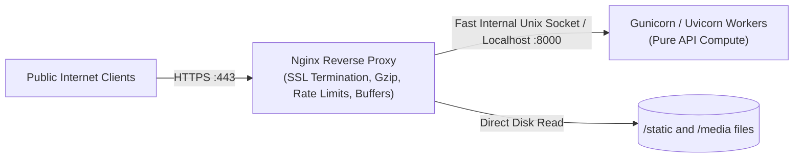

# Production Nginx Reverse Proxy Configuration

Exposing Python application servers (Gunicorn, Uvicorn) directly to the public internet is dangerous:
1. **Slow Client Attacks**: Slow 3G/4G mobile clients slowly transmitting bytes tie up Python worker processes.
2. **Static Asset Bottleneck**: Serving static files, CSS, or JS through Python consumes worker CPU.
3. **SSL/TLS Handshake Overhead**: Nginx handles cryptographic handshakes significantly faster than Python.

---

## 1. Nginx Architecture



---

## 2. Production `nginx.conf`

```nginx
# /etc/nginx/sites-available/production.conf

# Define upstream Python application cluster
upstream backend_app {
    server 127.0.0.1:8000;
    keepalive 32; # Reuses persistent TCP connections to backend
}

# Rate limiting zone: 20 requests per second per IP
limit_req_zone $binary_remote_addr zone=api_limit:10m rate=20r/s;

server {
    listen 80;
    server_name api.yourdomain.com;
    # Redirect all HTTP to HTTPS
    return 301 https://$host$request_uri;
}

server {
    listen 443 ssl http2;
    server_name api.yourdomain.com;

    # SSL Certificates (Let's Encrypt / Cloudflare)
    ssl_certificate /etc/letsencrypt/live/api.yourdomain.com/fullchain.pem;
    ssl_certificate_key /etc/letsencrypt/live/api.yourdomain.com/privkey.pem;
    ssl_protocols TLSv1.2 TLSv1.3;
    ssl_ciphers HIGH:!aNULL:!MD5;

    # Security Headers
    add_header X-Frame-Options "DENY" always;
    add_header X-Content-Type-Options "nosniff" always;
    add_header Strict-Transport-Security "max-age=31536000; includeSubDomains" always;

    # Client upload size limit
    client_max_body_size 50M;

    # 1. Static Files (Served directly from disk without touching Python!)
    location /static/ {
        alias /var/www/backend/static/;
        expires 30d;
        add_header Cache-Control "public, no-transform";
    }

    # 2. API Reverse Proxy
    location / {
        limit_req zone=api_limit burst=10 nodelay;

        proxy_pass http://backend_app;
        proxy_http_version 1.1;

        # Forward real client IP and protocol
        proxy_set_header Host $host;
        proxy_set_header X-Real-IP $remote_addr;
        proxy_set_header X-Forwarded-For $proxy_add_x_forwarded_for;
        proxy_set_header X-Forwarded-Proto $scheme;

        # WebSocket & Server-Sent Events (SSE) Support:
        proxy_set_header Upgrade $http_upgrade;
        proxy_set_header Connection "upgrade";
        proxy_buffering off; # Required for SSE streaming!

        # Timeouts
        proxy_connect_timeout 5s;
        proxy_read_timeout 60s;
    }
}
```

