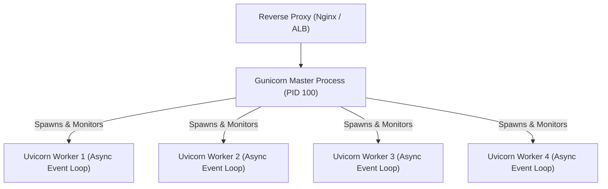

# Production Server Topologies: Gunicorn + Uvicorn Workers

In development, developers usually start servers with `uvicorn main:app --reload` or `python manage.py runserver`.

In production, running a single-process server is an immediate bottleneck: if an unhandled fatal error or C-extension crash occurs, the whole process terminates, taking down the entire website.

The industry-standard production setup pairs **Gunicorn** (as the process manager and supervisor) with **Uvicorn** (as the high-performance async worker).

---

## 1. Process Supervision Topology



* **Gunicorn Master**: Does not handle client HTTP requests. Its sole job is to bind to the socket, spawn worker processes, reload them gracefully without downtime upon deployment, and revive dead workers if one crashes.
* **Uvicorn Workers**: Handle the actual HTTP connections and run the FastAPI or Django ASGI application.

---

## 2. Worker Count Formula

How many workers should you run?

$$\text{Workers} = (2 \times \text{CPU Cores}) + 1$$

* On a **2-Core Container**: Run $2 \times 2 + 1 = 5$ workers.
* On a **4-Core VM**: Run $2 \times 4 + 1 = 9$ workers.

> **Caution for Async FastAPI**: Because each Uvicorn worker runs thousands of concurrent coroutines asynchronously on its event loop, having too many worker processes can cause heavy RAM consumption and database connection pool contention. In containerized Kubernetes pods, running **2 to 4 workers per pod** and autoscaling horizontally with the HPA (Horizontal Pod Autoscaler) is the preferred standard.

---

## 3. Production Gunicorn Configuration File

```python
# gunicorn.conf.py
import multiprocessing

bind = "0.0.0.0:8000"
workers = multiprocessing.cpu_count() * 2 + 1
worker_class = "uvicorn.workers.UvicornWorker"

# Timeouts
timeout = 60          # Worker killed if it does not notify master for 60 seconds
graceful_timeout = 30 # Allow 30 seconds for active requests to finish before SIGKILL
keepalive = 5

# Logging
accesslog = "-"       # Log access to stdout
errorlog = "-"        # Log errors to stderr
loglevel = "info"

# Maximum requests before worker recycling (prevents memory leaks)
max_requests = 10000
max_requests_jitter = 1000
```

Start command:
```bash
gunicorn -c gunicorn.conf.py app.main:app
```

