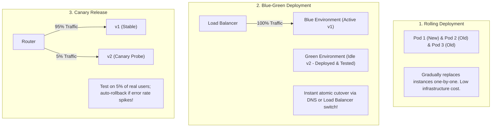

# Zero-Downtime Deployment Strategies: Rolling, Blue-Green & Canary

Deploying code updates should never require maintenance windows or scheduled downtime (*"Site will be down Sunday 2 AM to 4 AM"*).

Modern cloud engineering relies on three zero-downtime release strategies:

---

## 1. The Three Release Strategies Compared

| Strategy | Speed of Rollback | Infrastructure Cost | Risk Level |
| :--- | :--- | :--- | :--- |
| **Rolling Update** | Moderate (Roll backward pod-by-pod) | **Lowest** (Reuses same cluster) | Low |
| **Blue-Green** | **Instant** (Flip router back to Blue) | **High** (Requires 2x identical environments) | **Lowest** |
| **Canary** | Instant | Low to Moderate | **Lowest user impact** |

---

## 2. Automated Rollback Mechanisms
In any CI/CD pipeline, an automated rollback must trigger if:
1. HTTP 5xx error rate exceeds `1%` within 5 minutes of deployment.
2. The `/health/ready` probe fails 3 consecutive attempts on new containers.
3. Database connection pool errors spike.

