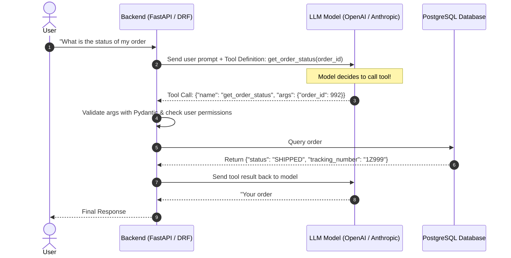

# AI Function Calling & Tool Invocation Architecture

Modern LLM agents do not just chat; they execute real backend actions: querying customer orders, processing refunds, creating calendar invites, and triggering database workflows.

This is powered by **Function Calling (Tool Invocation)**.

---

## 1. How Tool Calling Works

The LLM never directly executes your Python code. Instead, your backend supplies JSON Schemas describing available functions. The LLM outputs a structured JSON tool call, which your backend validates and executes:



---

## 2. Production Code: Tool Execution in FastAPI with Pydantic

```python
import json
from pydantic import BaseModel, Field
from fastapi import APIRouter, HTTPException

router = APIRouter()

# 1. Define Tool Schema using Pydantic
class GetOrderStatusArgs(BaseModel):
    order_id: int = Field(..., description="The unique integer ID of the order.")

# 2. Tool Definition format for LLM API
tools_schema = [
    {
        "type": "function",
        "function": {
            "name": "get_order_status",
            "description": "Look up real-time shipping status and tracking for a customer order.",
            "parameters": GetOrderStatusArgs.model_json_schema(),
        },
    }
]

# 3. Tool Dispatcher
async def execute_tool(tool_name: str, raw_arguments_json: str, current_user_id: int):
    if tool_name == "get_order_status":
        # Validate arguments using Pydantic
        args = GetOrderStatusArgs.model_validate_json(raw_arguments_json)

        # Enforce security / BOLA check
        order = await get_order_by_id(args.order_id)
        if not order or order.user_id != current_user_id:
            return {"error": "Order not found or unauthorized"}

        return {"order_id": order.id, "status": order.status, "tracking": order.tracking_number}

    raise ValueError(f"Unknown tool: {tool_name}")
```

---

## 3. Production Security Rules for Function Calling
* **Never Trust LLM Arguments Blindly**: Always validate arguments with Pydantic models before passing to SQL or APIs.
* **Always Enforce Authorization**: The LLM might ask to delete order `#1`, but if the active user is not the owner or an admin, reject the tool execution with a `403 Forbidden` error!

