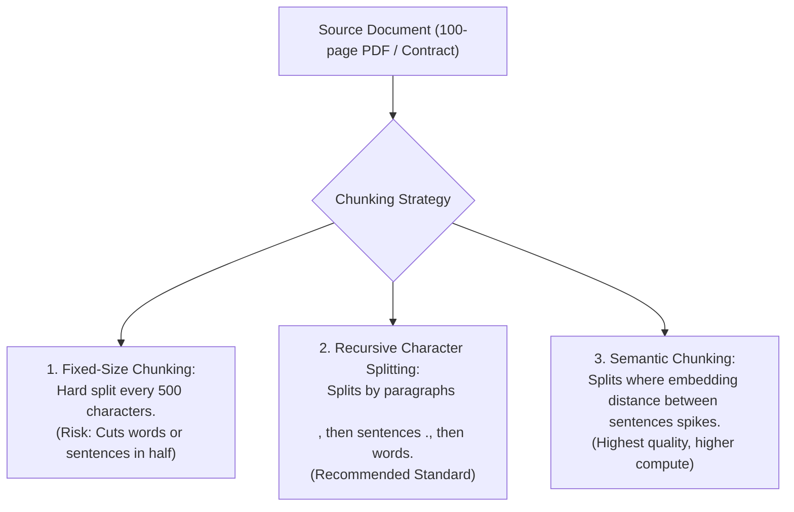

# Document Chunking, Token Budgeting & RAG Evaluation

In Retrieval-Augmented Generation (RAG), vector similarity search is only as good as the **quality of your document chunks**.

If your chunks are too large (e.g. 5,000 tokens), semantic embeddings lose precision and context windows overflow. If chunks are too small (e.g. 50 tokens), the model loses context.

---

## 1. Chunking Strategies Compared



### Why Chunk Overlap Matters:
Always include a **10% to 20% overlap** between consecutive chunks (e.g., chunk size = 500 tokens, overlap = 50 tokens). This guarantees that a critical sentence or entity name crossing a boundary is not severed.

---

## 2. Token Budgeting & Cost Calculation

LLM APIs charge per 1,000 or 1,000,000 tokens. A single runaway loop or uncontrolled prompt expansion can generate thousand-dollar surprise cloud bills.

### The Token Budget Formula:
$$\text{Total Tokens} = \text{System Prompt} + \text{Retrieved Chunks} + \text{Conversation History} + \text{Max Output Tokens}$$

```python
import tiktoken

def count_tokens(text: str, model: str = "gpt-4o") -> int:
    """Calculates exact token count before sending to LLM."""
    encoder = tiktoken.encoding_for_model(model)
    return len(encoder.encode(text))

def truncate_to_token_budget(chunks: list[str], max_token_budget: int = 3000) -> list[str]:
    """Ensures retrieved RAG context does not exceed budget."""
    total = 0
    selected_chunks = []
    for chunk in chunks:
        tokens = count_tokens(chunk)
        if total + tokens > max_token_budget:
            break
        selected_chunks.append(chunk)
        total += tokens
    return selected_chunks
```

---

## 3. RAG Evaluation Metrics (The RAG Triad)

How do you know if your RAG pipeline is actually working accurately?

1. **Context Relevance**: Did the vector search retrieve documents that are actually relevant to the user's question?
2. **Groundedness / Faithfulness**: Is the generated LLM response supported strictly by the retrieved documents (zero hallucination)?
3. **Answer Relevance**: Did the generated response answer the exact question the user asked?

