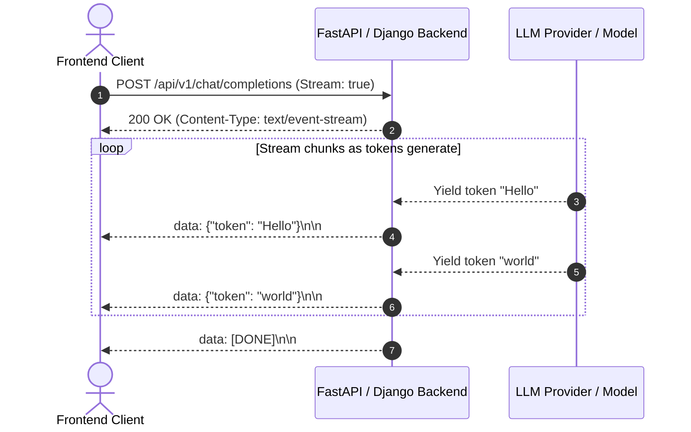

# Server-Sent Events (SSE) & LLM Token Streaming

In modern AI-powered backends, waiting for an LLM (OpenAI, Anthropic, Gemini, or local models) to complete a 1,000-word response takes 15 to 30 seconds. Buffering the entire text before returning an HTTP response causes high user latency, timeouts, and a terrible user experience.

The industry standard is **Server-Sent Events (SSE)** streaming tokens to the client character-by-character in real time.

---

## 1. How Server-Sent Events (SSE) Work

Unlike WebSockets (which are full-duplex and require complex handshake protocols), **SSE operates over standard HTTP/1.1 or HTTP/2** using the `text/event-stream` MIME type.



---

## 2. Production Code Implementations

=== "FastAPI (StreamingResponse with Async Generator)"
    ```python
    import json
    import asyncio
    from typing import AsyncGenerator
    from fastapi import APIRouter, Request
    from fastapi.responses import StreamingResponse
    from pydantic import BaseModel

    router = APIRouter(prefix="/ai", tags=["AI Streaming"])

    class ChatRequest(BaseModel):
        prompt: str

    async def token_stream_generator(prompt: str, request: Request) -> AsyncGenerator[str, None]:
        # Simulated async streaming client (e.g. OpenAI / Anthropic / Ollama)
        tokens = ["Hello", " there!", " This", " is", " streaming", " in", " real", " time."]

        for token in tokens:
            # Check if client disconnected / closed browser tab
            if await request.is_disconnected():
                # Stop generation immediately to avoid wasting expensive LLM GPU tokens!
                break

            yield f"data: {json.dumps({'token': token})}\n\n"
            await asyncio.sleep(0.08)  # Simulate token generation latency

        yield "data: [DONE]\n\n"

    @router.post("/chat/stream")
    async def chat_stream(payload: ChatRequest, request: Request):
        return StreamingResponse(
            token_stream_generator(prompt=payload.prompt, request=request),
            media_type="text/event-stream",
            headers={
                "Cache-Control": "no-cache",
                "Connection": "keep-alive",
                "X-Accel-Buffering": "no",  # Disables Nginx buffering so tokens stream instantly
            },
        )
    ```

=== "Django Channels (Async WebSocket / SSE Streaming)"
    In Django, streaming HTTP responses over traditional WSGI workers ties up a thread for the entire duration of the stream. Therefore, streaming in Django should run over **ASGI** using `StreamingHttpResponse`:

    ```python
    import json
    import time
    from django.http import StreamingHttpResponse

    def event_stream_generator():
        tokens = ["Real-time", " AI", " response", " via", " Django", " ASGI."]
        for token in tokens:
            yield f"data: {json.dumps({'token': token})}\n\n"
            time.sleep(0.1)
        yield "data: [DONE]\n\n"

    def chat_stream_view(request):
        response = StreamingHttpResponse(
            event_stream_generator(),
            content_type="text/event-stream"
        )
        response["Cache-Control"] = "no-cache"
        response["X-Accel-Buffering"] = "no"
        return response
    ```

---

## 3. Disconnection Handling
Always detect client disconnects via `request.is_disconnected()`. If a user navigates away or refreshes the page, immediately abort the generator and terminate the LLM API stream to prevent burning compute and billing tokens.

