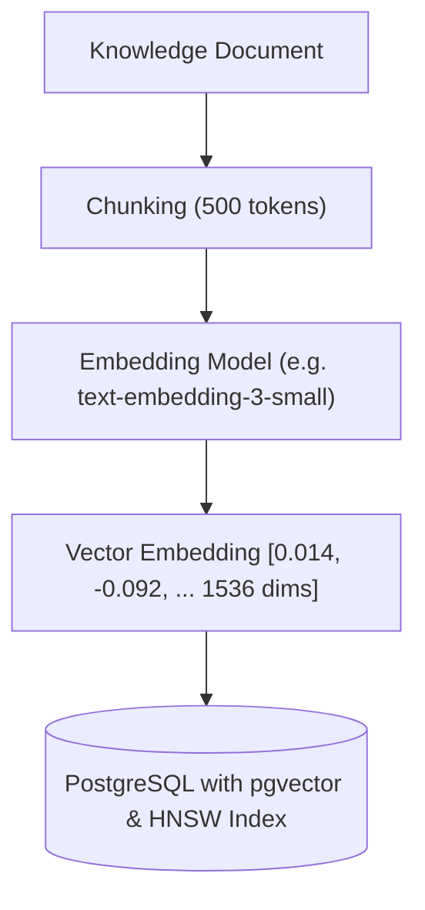

# Vector Databases & Hybrid Search (pgvector & Reciprocal Rank Fusion)

Retrieval-Augmented Generation (RAG) grounds LLM responses with proprietary private data.

However, relying **only** on vector semantic search produces poor results when queries contain exact product SKUs, serial numbers, acronyms, or specific error codes.

The production standard is **Hybrid Search**: combining **Full-Text Keyword Search (BM25)** with **Dense Vector Semantic Search** using **Reciprocal Rank Fusion (RRF)**.

---

## 1. Vector Search with PostgreSQL (`pgvector`)

Instead of spinning up another external database service, `pgvector` adds high-performance vector similarity search directly into your existing PostgreSQL instance.



### Vector Index Types in `pgvector`:
* **HNSW (Hierarchical Navigable Small World)**: Fast $O(\log N)$ query speed and high recall. Recommended for production.
* **IVFFlat**: Faster build times, but lower query throughput and requires re-indexing as data grows.

---

## 2. Production Code Implementations

=== "SQLAlchemy 2.0 + pgvector"
    ```python
    from pgvector.sqlalchemy import Vector
    from sqlalchemy import Column, Integer, String, Text, select
    from sqlalchemy.ext.asyncio import AsyncSession
    from app.core.database import Base

    class DocumentChunk(Base):
        __tablename__ = "document_chunks"

        id = Column(Integer, primary_key=True)
        content = Column(Text, nullable=False)
        # 1536 dimensions for OpenAI / 768 for open-source models
        embedding = Column(Vector(1536), nullable=False)

    async def search_similar_chunks(
        db: AsyncSession,
        query_vector: list[float],
        limit: int = 5,
    ) -> list[DocumentChunk]:
        # Uses cosine distance operator: <=>
        stmt = (
            select(DocumentChunk)
            .order_by(DocumentChunk.embedding.cosine_distance(query_vector))
            .limit(limit)
        )
        result = await db.execute(stmt)
        return result.scalars().all()
    ```

=== "Django REST Framework (pgvector-python)"
    ```python
    from django.db import models
    from pgvector.django import VectorField, CosineDistance

    class DocumentChunk(models.Model):
        content = models.TextField()
        embedding = VectorField(dimensions=1536)

    def search_similar_chunks(query_vector: list[float], limit: int = 5):
        # Query using pgvector cosine distance annotation
        return (
            DocumentChunk.objects
            .annotate(distance=CosineDistance("embedding", query_vector))
            .order_by("distance")[:limit]
        )
    ```

---

## 3. Hybrid Search: Reciprocal Rank Fusion (RRF)

Reciprocal Rank Fusion merges ranked results from two distinct search strategies:

$$RRF\_Score(d) = \sum_{m \in M} \frac{1}{k + r_m(d)}$$

Where $k \approx 60$ and $r_m(d)$ is the document's rank in search method $m$ (Full-Text vs Vector). This guarantees that documents matching both exact keywords and semantic meaning appear at the top.

