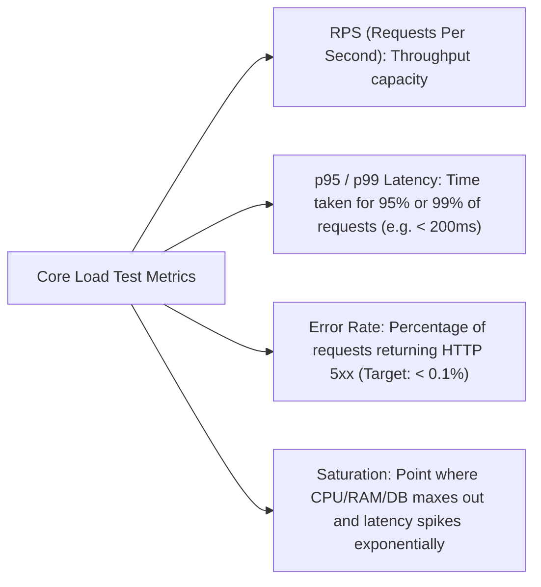

# Load & Performance Testing with k6 & Locust

Functional tests verify that your code works for 1 user. **Load tests** verify that your system does not collapse when 5,000 users hit the API at the same second.

---

## 1. Key Performance Metrics Explained Simply



---

## 2. Production Load Testing with k6

**k6** is the modern industry standard for performance testing. It is written in Go (giving it near-zero local CPU overhead) and configured using JavaScript.

### Complete k6 Load Test Script (`load_test.js`):
```javascript
import http from 'k6/http';
import { check, sleep } from 'k6';

export const options = {
  // Define traffic stages (ramp up -> sustained load -> ramp down)
  stages: [
    { duration: '30s', target: 50 },  // Ramp up to 50 concurrent virtual users
    { duration: '1m',  target: 100 }, // Sustain 100 users for 1 minute
    { duration: '20s', target: 0 },   // Ramp down to 0
  ],
  // Performance SLOs / Thresholds: Test fails if these criteria are violated!
  thresholds: {
    http_req_duration: ['p(95)<250'], // 95% of requests must complete within 250ms
    http_req_failed: ['rate<0.01'],   // Error rate must stay below 1%
  },
};

export default function () {
  const url = 'http://localhost:8000/api/v1/orders';
  const payload = JSON.stringify({
    product_id: 1,
    quantity: 2,
    idempotency_key: `key_${__VU}_${__ITER}`,
  });

  const params = {
    headers: {
      'Content-Type': 'application/json',
      'Authorization': 'Bearer test_token',
    },
  };

  const res = http.post(url, payload, params);

  // Assertions
  check(res, {
    'status is 201': (r) => r.status === 201,
  });

  sleep(0.5); // Simulate think time between user requests
}
```

Run test:
```bash
k6 run load_test.js
```

---

## 3. What to Monitor on the Backend During a Load Test
When running k6, observe your server metrics:
1. **PostgreSQL CPU & Connection Count**: Is PgBouncer queueing connections?
2. **Uvicorn / Gunicorn Event Loop Latency**: Are threads blocked by synchronous calls?
3. **Redis Memory & Hit Rate**: Are cache misses causing DB stampedes?

