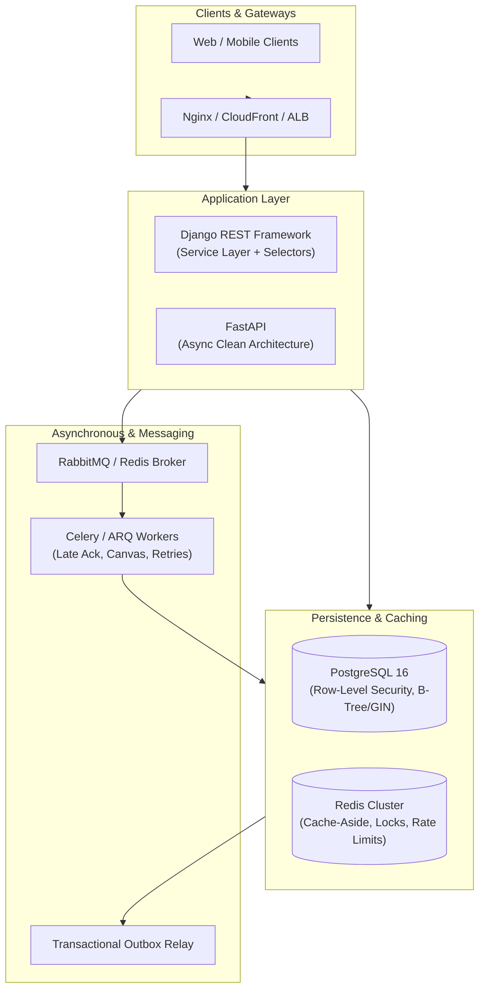

# All In One Backend Engineering Guide (DRF & FastAPI)

Welcome to the **All In One Backend Engineering System** — an enterprise-grade documentation portal and reference architecture covering modern backend development using **Django REST Framework (DRF)** and **FastAPI**.

This guide is designed for senior backend engineers, architects, and developers who want a production-proven reference when designing, scaling, securing, and debugging enterprise APIs.

---

## 🎯 What This Documentation Covers



---

## ⚖️ Framework Philosophies: DRF vs. FastAPI

Both Django REST Framework and FastAPI are world-class frameworks, but they serve different architectural philosophies:

| Dimension | Django REST Framework (DRF) | FastAPI |
| :--- | :--- | :--- |
| **Execution Model** | Synchronous WSGI (thread-per-worker model) | Asynchronous ASGI (single-threaded event loop) |
| **Philosophy** | "Batteries Included" (ORM, Admin, Migrations, Auth) | "Lightweight & Composable" (Pydantic, Starlette, Any ORM) |
| **Best For** | Complex relational business domains, CRUD-heavy SaaS | High-concurrency I/O, microservices, streaming, AI/RAG |
| **Data Validation** | DRF Serializers | Pydantic v2 (Rust-powered, high performance) |
| **Architecture Pattern** | Service-Selector Pattern (HackSoft style) | Clean / Hexagonal Architecture with `Depends()` |

---

## 📚 Master Engineering Modules

1. **[Architecture & Design](01-architecture/clean-architecture-service-layer.md)**: Clean Architecture, Service Layer vs Fat Models, SOLID, and Modular Monoliths.
2. **[Database Engineering](02-database-engineering/schema-design-indexing.md)**: Indexing, Pessimistic vs Optimistic locking, N+1 query elimination, Soft Deletes, and Connection Pooling.
3. **[API Engineering](03-api-engineering/rest-standards-response-envelope.md)**: Standardized envelopes, Keyset pagination, Idempotent requests, and S3 Presigned URLs.
4. **[Authentication & Security](04-auth-and-security/jwt-rotation-and-revocation.md)**: JWT token rotation, RBAC/ABAC, PostgreSQL Row-Level Security, and Rate Limiting.
5. **[Error Handling & Resilience](05-error-handling-resilience/rfc-7807-error-standards.md)**: RFC 7807 Problem Details, Circuit Breakers, and Exponential Retries.
6. **[Performance & Caching](06-caching-performance/redis-caching-patterns-stampede.md)**: Cache-Aside, Mutex Stampede Locks, and Async Event Loop Profiling.
7. **[Background Tasks & Queues](07-background-jobs-queues/celery-canvas-and-idempotency.md)**: Celery Late Ack, Chords, and Transactional Outbox Pattern.
8. **[Observability & Monitoring](08-observability-monitoring/structured-logging-correlation-id.md)**: Correlation IDs, Structured JSON Logs, and OpenTelemetry Spans.
9. **[DevOps & Deployment](09-devops-deployment/docker-production-builds.md)**: Multi-Stage Dockerfiles, Gunicorn/Uvicorn Worker Topologies, and CI/CD.
10. **[AI & RAG Backend](10-ai-rag-backend/streaming-sse-and-llm-apis.md)**: Server-Sent Events (SSE), pgvector Semantic Search, and Prompt Guardrails.

---

## 🚀 How to Run this Documentation Site Locally

To preview and search this documentation on your local machine:

```powershell
# 1. Activate the Python virtual environment
.\.venv\Scripts\Activate.ps1

# 2. Start the hot-reloading documentation server
mkdocs serve
```

Then open your browser at **`http://localhost:8000`**. Any markdown edits you make will automatically refresh the browser in real time!

